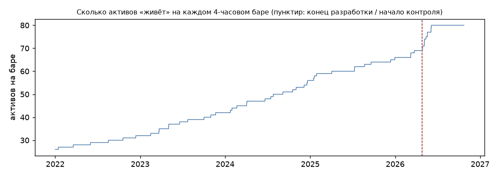

# Качество данных (Stage F2)

Источник: публичный REST Bybit, часовые свечи последней цены и премиум-индекса, часовой открытый интерес (OI),
история фандинга. 4-часовые бары собраны из часовых по границам UTC; бар есть, только если есть все 4 часа.

- Период анализа: 2022-01-01 … 2026-10-24 (данные качались с 2021-10-01 для разогрева окон).
- Длина: 57.7 мес. Контрольный период: последние **180 дней** (2026-04-27 … 2026-10-24), embargo 3 дня, разработка до 2026-04-24.
- Символов в списке Stage 4: 80; с данными: 80.
- Активов на бар: среднее **49.1**, минимум 26, максимум 80. Первый бар с данными: 2022-01-01 00:00:00+00:00.

## Критерий C1

Нужно ≥ 24 мес. истории и ≥ 40 активов в среднем на бар: **выполнен**.

## Активов на бар по годам

| index | mean | min | max |
|---|---|---|---|
| 2022 | 29 | 26 | 32 |
| 2023 | 37.3 | 32 | 42 |
| 2024 | 48.5 | 42 | 56 |
| 2025 | 61.2 | 56 | 66 |
| 2026 | 74.2 | 66 | 80 |

## Покрытие по активам

`missing_inside` — 4-часовые бары без полного набора часовых свечей внутри «жизни» актива; `*_cov` — доля баров жизни,
где есть значение (OI и фандинг берутся последним значением строго внутри бара); `dups` — повторы строк в сырых ответах (удалены).

| symbol | first_bar | last_bar | bars | missing_inside | premium_cov | oi_cov | funding_cov | dups |
|---|---|---|---|---|---|---|---|---|
| BTCUSDT | 2022-01-01 | 2026-10-23 | 10542 | 0 | 1 | 1 | 1 | 0 |
| ETHUSDT | 2022-01-01 | 2026-10-23 | 10542 | 0 | 1 | 1 | 1 | 0 |
| SOLUSDT | 2022-01-01 | 2026-10-23 | 10542 | 0 | 1 | 1 | 1 | 0 |
| NEARUSDT | 2022-01-01 | 2026-10-23 | 10542 | 0 | 1 | 1 | 1 | 0 |
| ZECUSDT | 2022-01-01 | 2026-10-23 | 10542 | 0 | 1 | 1 | 1 | 0 |
| XRPUSDT | 2022-01-01 | 2026-10-23 | 10542 | 0 | 1 | 1 | 1 | 0 |
| SOXLUSDT | 2026-05-19 | 2026-10-23 | 945 | 0 | 1 | 1 | 1 | 0 |
| STRKUSDT | 2024-02-20 | 2026-10-23 | 5858 | 0 | 1 | 1 | 1 | 0 |
| HYPEUSDT | 2024-12-05 | 2026-10-23 | 4125 | 0 | 1 | 1 | 1 | 0 |
| ENAUSDT | 2024-04-02 | 2026-10-23 | 5607 | 0 | 1 | 1 | 1 | 0 |
| XAUUSDT | 2026-03-09 | 2026-10-23 | 1373 | 0 | 1 | 1 | 1 | 0 |
| WUSDT | 2024-04-03 | 2026-10-23 | 5600 | 0 | 1 | 1 | 1 | 0 |
| DOGEUSDT | 2022-01-01 | 2026-10-23 | 10542 | 0 | 1 | 1 | 1 | 0 |
| WLDUSDT | 2023-07-24 | 2026-10-23 | 7125 | 0 | 1 | 1 | 1 | 0 |
| SUIUSDT | 2023-05-03 | 2026-10-23 | 7616 | 0 | 1 | 1 | 1 | 0 |
| RSRUSDT | 2022-01-01 | 2026-10-23 | 10542 | 0 | 1 | 1 | 1 | 0 |
| ADAUSDT | 2022-01-01 | 2026-10-23 | 10542 | 0 | 1 | 1 | 1 | 0 |
| ONDOUSDT | 2024-01-23 | 2026-10-23 | 6027 | 0 | 1 | 1 | 1 | 0 |
| PUMPFUNUSDT | 2025-07-10 | 2026-10-23 | 2824 | 0 | 1 | 1 | 1 | 0 |
| NVDAUSDT | 2026-05-06 | 2026-10-23 | 1023 | 0 | 1 | 1 | 1 | 0 |
| CLUSDT | 2026-03-24 | 2026-10-23 | 1282 | 0 | 1 | 1 | 1 | 0 |
| SNDKUSDT | 2026-04-28 | 2026-10-23 | 1072 | 0 | 1 | 1 | 1 | 0 |
| SKHYNIXUSDT | 2026-06-04 | 2026-10-23 | 851 | 0 | 1 | 1 | 1 | 0 |
| 1000PEPEUSDT | 2023-05-03 | 2026-10-23 | 7617 | 0 | 1 | 1 | 1 | 0 |
| ZROUSDT | 2024-06-20 | 2026-10-23 | 5132 | 0 | 1 | 1 | 1 | 0 |
| UNIUSDT | 2022-01-01 | 2026-10-23 | 10542 | 0 | 1 | 1 | 1 | 0 |
| TIAUSDT | 2023-10-31 | 2026-10-23 | 6529 | 0 | 1 | 1 | 1 | 0 |
| AVAXUSDT | 2022-01-01 | 2026-10-23 | 10542 | 0 | 1 | 1 | 1 | 0 |
| LINKUSDT | 2022-01-01 | 2026-10-23 | 10542 | 0 | 1 | 1 | 1 | 0 |
| OGNUSDT | 2022-03-19 | 2026-10-23 | 10077 | 0 | 1 | 1 | 1 | 0 |
| TAOUSDT | 2024-01-30 | 2026-10-23 | 5985 | 0 | 1 | 1 | 1 | 0 |
| INJUSDT | 2022-08-17 | 2026-10-23 | 9172 | 0 | 1 | 1 | 1 | 0 |
| MSTRUSDT | 2026-04-29 | 2026-10-23 | 1066 | 0 | 1 | 1 | 1 | 0 |
| STXUSDT | 2022-01-01 | 2026-10-23 | 10542 | 0 | 1 | 1 | 1 | 0 |
| MUUSDT | 2026-05-07 | 2026-10-23 | 1018 | 0 | 1 | 1 | 1 | 0 |
| ARBUSDT | 2023-03-23 | 2026-10-23 | 7862 | 0 | 1 | 1 | 1 | 0 |
| HBARUSDT | 2022-01-01 | 2026-10-23 | 10542 | 0 | 1 | 1 | 1 | 0 |
| AAVEUSDT | 2022-01-01 | 2026-10-23 | 10542 | 0 | 1 | 1 | 1 | 0 |
| BNBUSDT | 2022-01-01 | 2026-10-23 | 10542 | 0 | 1 | 1 | 1 | 0 |
| LITUSDT | 2025-12-30 | 2026-10-23 | 1784 | 0 | 1 | 1 | 1 | 0 |
| PYTHUSDT | 2023-11-21 | 2026-10-23 | 6406 | 0 | 1 | 1 | 1 | 0 |
| FILUSDT | 2022-01-01 | 2026-10-23 | 10542 | 0 | 1 | 1 | 1 | 0 |
| BTWUSDT | 2026-06-05 | 2026-10-23 | 844 | 0 | 1 | 1 | 1 | 0 |
| LTCUSDT | 2022-01-01 | 2026-10-23 | 10542 | 0 | 1 | 1 | 1 | 0 |
| APTUSDT | 2022-10-19 | 2026-10-23 | 8795 | 0 | 1 | 1 | 1 | 0 |
| QNTUSDT | 2023-06-19 | 2026-10-23 | 7335 | 0 | 1 | 1 | 1 | 0 |
| DOTUSDT | 2022-01-01 | 2026-10-23 | 10542 | 0 | 1 | 1 | 1 | 0 |
| RENDERUSDT | 2024-07-26 | 2026-10-23 | 4918 | 0 | 1 | 1 | 1 | 0 |
| XAGUSDT | 2026-03-09 | 2026-10-23 | 1373 | 0 | 1 | 1 | 1 | 0 |
| TRUMPUSDT | 2025-01-18 | 2026-10-23 | 3861 | 0 | 1 | 1 | 1 | 0 |
| GRASSUSDT | 2024-10-17 | 2026-10-23 | 4419 | 0 | 1 | 1 | 1 | 0 |
| BZUSDT | 2026-05-13 | 2026-10-23 | 982 | 0 | 1 | 1 | 1 | 0 |
| ICPUSDT | 2022-01-01 | 2026-10-23 | 10542 | 0 | 1 | 1 | 1 | 0 |
| OPUSDT | 2022-06-01 | 2026-10-23 | 9633 | 0 | 1 | 1 | 1 | 0 |
| XPLUSDT | 2025-08-22 | 2026-10-23 | 2565 | 0 | 1 | 1 | 1 | 0 |
| SUSDT | 2025-01-15 | 2026-10-23 | 3879 | 0 | 1 | 1 | 1 | 0 |
| USUSDT | 2025-12-12 | 2026-10-23 | 1893 | 0 | 1 | 1 | 1 | 0 |
| MAGICUSDT | 2022-12-13 | 2026-10-23 | 8464 | 0 | 1 | 1 | 1 | 0 |
| XAUTUSDT | 2025-04-03 | 2026-10-23 | 3411 | 0 | 1 | 1 | 1 | 0 |
| BCHUSDT | 2022-01-01 | 2026-10-23 | 10542 | 0 | 1 | 1 | 1 | 0 |
| XLMUSDT | 2022-01-01 | 2026-10-23 | 10542 | 0 | 1 | 1 | 1 | 0 |
| SANDUSDT | 2022-01-01 | 2026-10-23 | 10542 | 0 | 1 | 1 | 1 | 0 |
| ATOMUSDT | 2022-01-01 | 2026-10-23 | 10542 | 0 | 1 | 1 | 1 | 0 |
| FARTCOINUSDT | 2024-12-20 | 2026-10-23 | 4035 | 0 | 1 | 1 | 1 | 0 |
| BATUSDT | 2022-01-01 | 2026-10-23 | 10542 | 0 | 1 | 1 | 1 | 0 |
| CRVUSDT | 2022-01-01 | 2026-10-23 | 10542 | 0 | 1 | 1 | 1 | 0 |
| BLURUSDT | 2023-02-15 | 2026-10-23 | 8080 | 0 | 1 | 1 | 1 | 0 |
| USELESSUSDT | 2025-07-10 | 2026-10-23 | 2823 | 0 | 1 | 1 | 1 | 0 |
| RLCUSDT | 2023-03-22 | 2026-10-23 | 7869 | 0 | 1 | 1 | 1 | 0 |
| AEROUSDT | 2024-07-15 | 2026-10-23 | 4983 | 0 | 1 | 1 | 1 | 0 |
| VVVUSDT | 2025-01-28 | 2026-10-23 | 3803 | 0 | 1 | 1 | 1 | 0 |
| PENGUUSDT | 2024-12-17 | 2026-10-23 | 4052 | 0 | 1 | 1 | 1 | 0 |
| XMRUSDT | 2022-01-14 | 2026-10-23 | 10461 | 0 | 1 | 1 | 1 | 0 |
| MNTUSDT | 2023-10-02 | 2026-10-23 | 6706 | 0 | 1 | 1 | 1 | 0 |
| ASTERUSDT | 2025-09-19 | 2026-10-23 | 2397 | 0 | 1 | 1 | 1 | 0 |
| KAIAUSDT | 2024-11-01 | 2026-10-23 | 4329 | 0 | 1 | 1 | 1 | 0 |
| CRCLUSDT | 2026-05-06 | 2026-10-23 | 1024 | 0 | 1 | 1 | 1 | 0 |
| SAMSUNGUSDT | 2026-06-04 | 2026-10-23 | 851 | 0 | 1 | 1 | 1 | 0 |
| POLUSDT | 2024-09-05 | 2026-10-23 | 4671 | 0 | 1 | 1 | 1 | 0 |
| DRAMUSDT | 2026-05-19 | 2026-10-23 | 945 | 0 | 1 | 1 | 1 | 0 |

## Смещение выживших

Список из 80 контрактов взят из Stage 4 (снимок 2026-10-13: топ по обороту среди торгующихся). Контракты, которые
за 2022–2026 годы были сняты с торгов или упали в обороте, в выборку не попали, а исторические данные по
делистингованным контрактам через этот API недоступны. Значит, в начале периода выборка смещена к «выжившим и
выросшим» активам. Для сравнения целей между собой это смещение общее, но абсолютные цифры доходности могут быть
завышены (или искажены в любую сторону для стратегий, ставящих против слабых активов).
