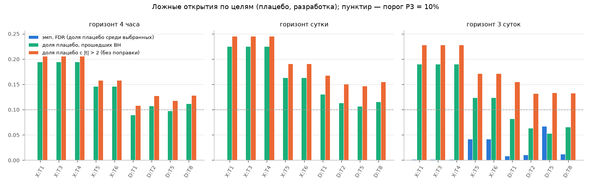

# Плацебо и ложные открытия

На каждом переобучении к  реальным признакам добавлялись свежие плацебо (20% от числа реальных):
половина — реальные признаки, сдвинутые по времени внутри каждого актива на случайное смещение ≥ 60 суток (циклически),
половина — шум AR(1) с φ ∈ {0,5; 0,9; 0,98}. Плацебо проходили **тот же** отбор. Цифры по всем месяцам разработки:

- `placebo_pass_rate` — доля плацебо, прошедших BH (эмпирическая доля ложных срабатываний);
- `placebo_fdr` — доля плацебо среди **выбранных** признаков (эмпирический FDR; пусто, если ничего не выбиралось);
- `placebo_naive_rate` — доля плацебо с |t| > 2 без поправки;
- `type1_*`, `type2_*` — то же отдельно для сдвинутых реальных признаков (тип 1) и шума AR(1) (тип 2);
- `real_pass_rate`, `real_naive_rate` — то же для реальных признаков (для сравнения);
- `no_find` — доля месяцев без находок; `jaccard` — средний индекс Жаккара наборов признаков соседних месяцев.

| branch | target | h | placebo_pass_rate | placebo_fdr | placebo_naive_rate | type1_pass_rate | type2_pass_rate | type2_naive_rate | type1_fdr | type2_fdr | real_pass_rate | real_naive_rate | no_find | mean_selected | jaccard |
|---|---|---|---|---|---|---|---|---|---|---|---|---|---|---|---|
| X | T1 | 1 | 0.194 | 0 | 0.205 | 0.359 | 0.028 | 0.037 | 0 | 0 | 0.82 | 0.829 | 0 | 20 | 0.887 |
| X | T1 | 6 | 0.224 | 0 | 0.244 | 0.394 | 0.055 | 0.074 | 0 | 0 | 0.737 | 0.757 | 0 | 20 | 0.94 |
| X | T1 | 18 | 0.19 | 0.001 | 0.228 | 0.335 | 0.045 | 0.077 | 0.001 | 0 | 0.536 | 0.6 | 0 | 20 | 0.826 |
| X | T3 | 1 | 0.194 | 0 | 0.205 | 0.359 | 0.028 | 0.037 | 0 | 0 | 0.82 | 0.829 | 0 | 20 | 0.887 |
| X | T3 | 6 | 0.224 | 0 | 0.244 | 0.394 | 0.055 | 0.074 | 0 | 0 | 0.737 | 0.757 | 0 | 20 | 0.94 |
| X | T3 | 18 | 0.19 | 0.001 | 0.228 | 0.335 | 0.045 | 0.077 | 0.001 | 0 | 0.536 | 0.6 | 0 | 20 | 0.826 |
| X | T4 | 1 | 0.194 | 0 | 0.205 | 0.359 | 0.028 | 0.037 | 0 | 0 | 0.82 | 0.829 | 0 | 20 | 0.887 |
| X | T4 | 6 | 0.224 | 0 | 0.244 | 0.394 | 0.055 | 0.074 | 0 | 0 | 0.737 | 0.757 | 0 | 20 | 0.94 |
| X | T4 | 18 | 0.19 | 0.001 | 0.228 | 0.335 | 0.045 | 0.077 | 0.001 | 0 | 0.536 | 0.6 | 0 | 20 | 0.826 |
| X | T5 | 1 | 0.146 | 0 | 0.158 | 0.263 | 0.028 | 0.035 | 0 | 0 | 0.781 | 0.794 | 0 | 20 | 0.913 |
| X | T5 | 6 | 0.162 | 0 | 0.19 | 0.272 | 0.053 | 0.076 | 0 | 0 | 0.665 | 0.692 | 0 | 20 | 0.837 |
| X | T5 | 18 | 0.123 | 0.041 | 0.171 | 0.205 | 0.041 | 0.075 | 0.04 | 0.001 | 0.464 | 0.531 | 0 | 20 | 0.728 |
| X | T6 | 1 | 0.146 | 0 | 0.158 | 0.263 | 0.028 | 0.035 | 0 | 0 | 0.781 | 0.794 | 0 | 20 | 0.913 |
| X | T6 | 6 | 0.162 | 0 | 0.19 | 0.272 | 0.053 | 0.076 | 0 | 0 | 0.665 | 0.692 | 0 | 20 | 0.837 |
| X | T6 | 18 | 0.123 | 0.041 | 0.171 | 0.205 | 0.041 | 0.075 | 0.04 | 0.001 | 0.464 | 0.531 | 0 | 20 | 0.728 |
| D | T1 | 1 | 0.089 | 0 | 0.108 | 0.158 | 0.021 | 0.035 | 0 | 0 | 0.696 | 0.714 | 0 | 20 | 0.639 |
| D | T1 | 6 | 0.129 | 0 | 0.167 | 0.21 | 0.049 | 0.082 | 0 | 0 | 0.509 | 0.563 | 0 | 20 | 0.575 |
| D | T1 | 18 | 0.081 | 0.008 | 0.154 | 0.139 | 0.024 | 0.083 | 0.008 | 0 | 0.227 | 0.307 | 0.025 | 19.5 | 0.472 |
| D | T2 | 1 | 0.107 | 0 | 0.127 | 0.192 | 0.022 | 0.035 | 0 | 0 | 0.672 | 0.694 | 0 | 20 | 0.563 |
| D | T2 | 6 | 0.113 | 0 | 0.15 | 0.183 | 0.043 | 0.078 | 0 | 0 | 0.519 | 0.566 | 0 | 20 | 0.593 |
| D | T2 | 18 | 0.062 | 0.01 | 0.131 | 0.109 | 0.016 | 0.077 | 0.01 | 0 | 0.212 | 0.318 | 0.025 | 19.5 | 0.524 |
| D | T5 | 1 | 0.097 | 0 | 0.117 | 0.171 | 0.024 | 0.035 | 0 | 0 | 0.676 | 0.696 | 0 | 20 | 0.674 |
| D | T5 | 6 | 0.106 | 0 | 0.146 | 0.164 | 0.047 | 0.082 | 0 | 0 | 0.473 | 0.533 | 0 | 20 | 0.577 |
| D | T5 | 18 | 0.052 | 0.067 | 0.133 | 0.087 | 0.017 | 0.083 | 0.061 | 0.005 | 0.134 | 0.277 | 0.025 | 18.4 | 0.416 |
| D | T8 | 1 | 0.111 | 0 | 0.128 | 0.2 | 0.023 | 0.034 | 0 | 0 | 0.696 | 0.715 | 0 | 20 | 0.555 |
| D | T8 | 6 | 0.115 | 0 | 0.154 | 0.187 | 0.044 | 0.082 | 0 | 0 | 0.519 | 0.565 | 0 | 20 | 0.596 |
| D | T8 | 18 | 0.065 | 0.012 | 0.132 | 0.113 | 0.017 | 0.076 | 0.012 | 0 | 0.217 | 0.322 | 0.025 | 19.5 | 0.532 |

**Проверка ожидания «у T1 (тяжёлые хвосты) ложных срабатываний больше».** В ветке X средняя доля плацебо, прошедших BH:
T1 0.203, T3 0.203, T4 0.203, T5 0.144, T6 0.144. У T1 она **выше** среднего по остальным целям ветки X.
Замечание: в ветке X ранговый IC не зависит от хвостов (T1, T3, T4 дают одинаковый отбор), поэтому эффект хвостов
может проявиться только через ветку D (пул по всем парам) и через модель, а не через отбор.
