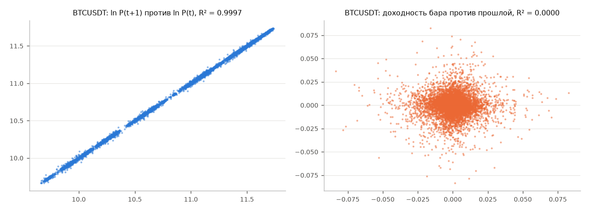

# Почему не предсказываем уровень цены (T0)

Данные: 5 самых ликвидных активов, 4-часовые бары, только период разработки (2022-01-01 … 2026-04-24).

| актив | баров | R² lnP(t+1) по lnP(t) | R² r(t+1) по r(t) | ADF lnP | ADF r |
|---|---|---|---|---|---|
| BTCUSDT | 9444 | 0.9997 | 3.615e-05 | -0.744 | -22.48 |
| ETHUSDT | 9444 | 0.9983 | 2.21e-05 | -2.211 | -28.06 |
| SOLUSDT | 9444 | 0.9994 | 9.077e-06 | -1.244 | -40.54 |
| NEARUSDT | 9444 | 0.9989 | 4.171e-05 | -2.304 | -28.04 |
| ZECUSDT | 9444 | 0.9992 | 0.0005979 | -0.6774 | -19.56 |

**Как читать.** R² «предсказания» логарифма цены следующего бара по текущему почти равен 1, но это не умение
предсказывать: ряд цены просто «помнит» своё положение (он нестационарен — тест Дики–Фуллера не отвергает
единичный корень, статистика выше критического значения −2,86 для 5%). Такая модель говорит «завтра цена будет
примерно как сегодня» и ничего не даёт для торговли. Как только переходим к изменению цены (доходности), R²
падает почти до нуля, а ряд становится стационарным (ADF сильно ниже −3,43). Вся торгуемая информация — в
доходности, а её предсказуемость мала.

Критические значения ADF (с константой, асимптотические MacKinnon): 1% −3,43; 5% −2,86; 10% −2,57.

**Вывод:** цену не предсказываем; дальше это не обсуждается.
