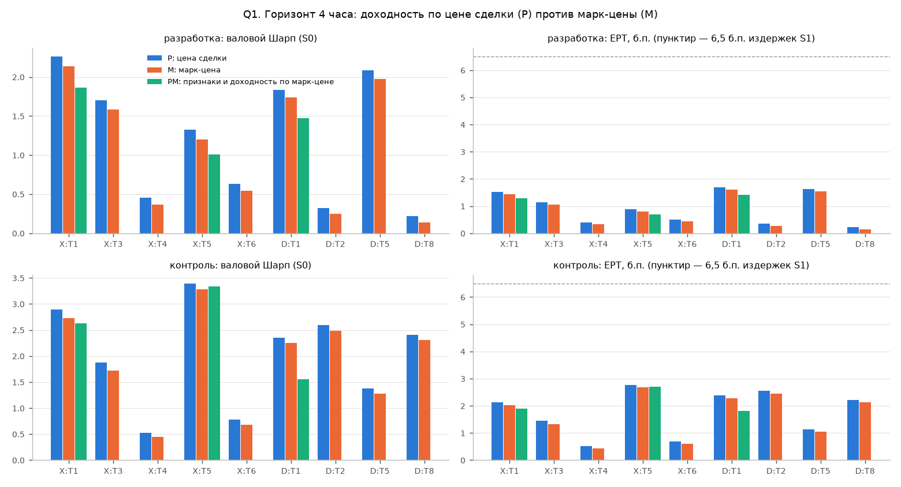

# Q1. Проверка на отскок между bid и ask (h = 1, 4 часа)

**Отскок между bid и ask** — цена последней сделки случайно попадает то на лучшую цену покупки, то на лучшую цену продажи,
и цена «прыгает» без реального движения. **Марк-цена** — справедливая цена контракта, которую считает биржа; на ней этого нет.
**EPT (выигрыш на единицу оборота)** — валовая прибыль (цена + фандинг) / оборот, в б.п.; сравнивается с ценой одной стороны сделки (6,5 б.п. в S1).

Варианты: **P** — как в F2 (доходность по открытию последней сделки); **M** — те же прогнозы и веса F2, доходность по марк-цене
открытия следующего бара; **PM** — признаки и цель обучения по марк-цене (OHLC; оборот, объём, OI, фандинг, премиум — как в F2),
модель переобучена тем же walk-forward F2 (X:T1, X:T5, D:T1). Сравнение на общем покрытии: актив исключается на баре, если
нет марк-цены для его ближайшего бара удержания. Активы с покрытием марк-цен < 99% от покрытия цен сделок: нет
(общее покрытие 100.00% баров).

## Вывод (правило заморожено; решающие числа — разработка)

**сигнал настоящий.**

Правило: «артефакт», если EPT_M ≤ 50% EPT_P или нижняя граница 90% интервала Шарпа M ≤ 0; «сигнал настоящий», если EPT_M ≥ 80% EPT_P и
нижняя граница > 0; иначе «частично артефакт». Общий вывод — по трём лучшим стратегиям F2 (X:T1, X:T5, D:T1), см. `open_questions_F2b.md`.

| branch | target | ept_M_over_P | sharpe_M_ci_lo | verdict |
|---|---|---|---|---|
| X | T1 | 0.946 | 1.157 | сигнал настоящий |
| X | T3 | 0.93 | 0.613 | сигнал настоящий |
| X | T4 | 0.815 | -0.53 | артефакт |
| X | T5 | 0.903 | 0.33 | сигнал настоящий |
| X | T6 | 0.861 | -0.363 | артефакт |
| D | T1 | 0.948 | 0.802 | сигнал настоящий |
| D | T2 | 0.774 | -0.6 | артефакт |
| D | T5 | 0.947 | 1.033 | сигнал настоящий |
| D | T8 | 0.636 | -0.755 | артефакт |

## Метрики

`gross_sharpe_S0` — валовой Шарп (цена + фандинг, без издержек); `ci_lo/ci_hi` — 90% интервал для M (блочный бутстреп 7 дней, 2000 повторов);
`ept_bp` — EPT; `ept_price_only_bp` — без фандинга; `ic` — IC прогноза с целью (P — цель по ценам сделок, M и PM — по марк-цене).

| period | branch | target | variant | gross_sharpe_S0 | ci_lo | ci_hi | ept_bp | ept_price_only_bp | turnover_day | ic | days |
|---|---|---|---|---|---|---|---|---|---|---|---|
| dev | X | T1 | P | 2.261 | nan | nan | 1.525 | 1.532 | 8.564 | 0.031 | 1209 |
| holdout | X | T1 | P | 2.895 | nan | nan | 2.133 | 2.079 | 8.188 | 0.031 | 180 |
| dev | X | T3 | P | 1.7 | nan | nan | 1.137 | 1.14 | 8.613 | 0.031 | 1209 |
| holdout | X | T3 | P | 1.873 | nan | nan | 1.445 | 1.397 | 8.257 | 0.032 | 180 |
| dev | X | T4 | P | 0.453 | nan | nan | 0.405 | 0.496 | 7.505 | 0.051 | 1209 |
| holdout | X | T4 | P | 0.529 | nan | nan | 0.517 | 0.532 | 7.09 | 0.053 | 180 |
| dev | X | T5 | P | 1.326 | nan | nan | 0.878 | 0.931 | 8.947 | 0.033 | 1209 |
| holdout | X | T5 | P | 3.393 | nan | nan | 2.776 | 2.78 | 8.639 | 0.039 | 180 |
| dev | X | T6 | P | 0.629 | nan | nan | 0.503 | 0.582 | 8.079 | 0.046 | 1209 |
| holdout | X | T6 | P | 0.783 | nan | nan | 0.685 | 0.686 | 7.44 | 0.05 | 180 |
| dev | D | T1 | P | 1.837 | nan | nan | 1.688 | 1.739 | 9.781 | 0.016 | 1209 |
| holdout | D | T1 | P | 2.354 | nan | nan | 2.382 | 2.413 | 9.239 | 0.025 | 180 |
| dev | D | T2 | P | 0.323 | nan | nan | 0.349 | 0.428 | 4.457 | 0.028 | 1209 |
| holdout | D | T2 | P | 2.599 | nan | nan | 2.551 | 2.534 | 4.746 | 0.036 | 180 |
| dev | D | T5 | P | 2.087 | nan | nan | 1.624 | 1.663 | 9.55 | 0.015 | 1209 |
| holdout | D | T5 | P | 1.378 | nan | nan | 1.13 | 1.087 | 9.164 | 0.024 | 180 |
| dev | D | T8 | P | 0.217 | nan | nan | 0.238 | 0.334 | 4.263 | 0.029 | 1209 |
| holdout | D | T8 | P | 2.41 | nan | nan | 2.214 | 2.219 | 4.39 | 0.036 | 180 |
| dev | X | T1 | M | 2.138 | 1.157 | 3.054 | 1.442 | 1.45 | 8.564 | 0.029 | 1209 |
| holdout | X | T1 | M | 2.731 | 0.724 | 5.188 | 2.016 | 1.962 | 8.188 | 0.03 | 180 |
| dev | X | T3 | M | 1.58 | 0.613 | 2.548 | 1.057 | 1.06 | 8.613 | 0.03 | 1209 |
| holdout | X | T3 | M | 1.72 | -0.563 | 4.301 | 1.329 | 1.281 | 8.257 | 0.031 | 180 |
| dev | X | T4 | M | 0.368 | -0.53 | 1.245 | 0.33 | 0.421 | 7.505 | 0.05 | 1209 |
| holdout | X | T4 | M | 0.449 | -1.866 | 2.669 | 0.438 | 0.454 | 7.09 | 0.053 | 180 |
| dev | X | T5 | M | 1.197 | 0.33 | 2.039 | 0.793 | 0.845 | 8.947 | 0.032 | 1209 |
| holdout | X | T5 | M | 3.286 | 1.012 | 5.92 | 2.689 | 2.693 | 8.639 | 0.037 | 180 |
| dev | X | T6 | M | 0.541 | -0.363 | 1.452 | 0.433 | 0.512 | 8.079 | 0.045 | 1209 |
| holdout | X | T6 | M | 0.685 | -2.068 | 3.3 | 0.6 | 0.601 | 7.44 | 0.049 | 180 |
| dev | D | T1 | M | 1.741 | 0.802 | 2.709 | 1.6 | 1.651 | 9.781 | 0.015 | 1209 |
| holdout | D | T1 | M | 2.252 | 0.362 | 4.291 | 2.281 | 2.311 | 9.239 | 0.024 | 180 |
| dev | D | T2 | M | 0.25 | -0.6 | 1.104 | 0.27 | 0.35 | 4.457 | 0.027 | 1209 |
| holdout | D | T2 | M | 2.489 | 0.242 | 4.859 | 2.445 | 2.428 | 4.746 | 0.035 | 180 |
| dev | D | T5 | M | 1.975 | 1.033 | 2.902 | 1.538 | 1.577 | 9.55 | 0.015 | 1209 |
| holdout | D | T5 | M | 1.276 | -0.201 | 2.93 | 1.047 | 1.003 | 9.164 | 0.023 | 180 |
| dev | D | T8 | M | 0.138 | -0.755 | 1.069 | 0.151 | 0.247 | 4.263 | 0.028 | 1209 |
| holdout | D | T8 | M | 2.311 | -0.511 | 5.466 | 2.124 | 2.129 | 4.39 | 0.036 | 180 |
| dev | X | T1 | PM | 1.863 | nan | nan | 1.279 | 1.282 | 8.381 | 0.028 | 1209 |
| holdout | X | T1 | PM | 2.623 | nan | nan | 1.9 | 1.837 | 8.015 | 0.029 | 180 |
| dev | X | T5 | PM | 1.005 | nan | nan | 0.699 | 0.751 | 8.787 | 0.031 | 1209 |
| holdout | X | T5 | PM | 3.34 | nan | nan | 2.697 | 2.719 | 8.51 | 0.04 | 180 |
| dev | D | T1 | PM | 1.472 | nan | nan | 1.417 | 1.478 | 9.627 | 0.015 | 1209 |
| holdout | D | T1 | PM | 1.551 | nan | nan | 1.806 | 1.843 | 9.089 | 0.024 | 180 |

## Разность P − M (парная, блочный бутстреп)

`bounce_share` = (EPT_P − EPT_M) / EPT_P — доля сигнала, объяснённая отскоком.

| period | branch | target | sharpe_P_minus_M | lo | hi | ept_P | ept_M | bounce_share | ept_M_over_P |
|---|---|---|---|---|---|---|---|---|---|
| dev | X | T1 | 0.123 | 0.094 | 0.153 | 1.525 | 1.442 | 0.054 | 0.946 |
| holdout | X | T1 | 0.165 | 0.117 | 0.231 | 2.133 | 2.016 | 0.055 | 0.945 |
| dev | X | T3 | 0.12 | 0.087 | 0.147 | 1.137 | 1.057 | 0.07 | 0.93 |
| holdout | X | T3 | 0.154 | 0.115 | 0.207 | 1.445 | 1.329 | 0.08 | 0.92 |
| dev | X | T4 | 0.084 | 0.061 | 0.115 | 0.405 | 0.33 | 0.185 | 0.815 |
| holdout | X | T4 | 0.08 | 0.037 | 0.131 | 0.517 | 0.438 | 0.152 | 0.848 |
| dev | X | T5 | 0.129 | 0.099 | 0.163 | 0.878 | 0.793 | 0.097 | 0.903 |
| holdout | X | T5 | 0.107 | 0.064 | 0.161 | 2.776 | 2.689 | 0.031 | 0.969 |
| dev | X | T6 | 0.088 | 0.061 | 0.118 | 0.503 | 0.433 | 0.139 | 0.861 |
| holdout | X | T6 | 0.098 | 0.059 | 0.145 | 0.685 | 0.6 | 0.124 | 0.876 |
| dev | D | T1 | 0.096 | 0.072 | 0.127 | 1.688 | 1.6 | 0.052 | 0.948 |
| holdout | D | T1 | 0.102 | 0.051 | 0.16 | 2.382 | 2.281 | 0.043 | 0.957 |
| dev | D | T2 | 0.073 | 0.051 | 0.097 | 0.349 | 0.27 | 0.226 | 0.774 |
| holdout | D | T2 | 0.109 | 0.068 | 0.159 | 2.551 | 2.445 | 0.042 | 0.958 |
| dev | D | T5 | 0.112 | 0.084 | 0.143 | 1.624 | 1.538 | 0.053 | 0.947 |
| holdout | D | T5 | 0.103 | 0.058 | 0.154 | 1.13 | 1.047 | 0.074 | 0.926 |
| dev | D | T8 | 0.079 | 0.058 | 0.103 | 0.238 | 0.151 | 0.364 | 0.636 |
| holdout | D | T8 | 0.1 | 0.056 | 0.158 | 2.214 | 2.124 | 0.041 | 0.959 |

## По терцилям ликвидности (средний 4-часовой оборот актива на разработке)

`half_spread_bp` — медиана половины медианного L1-спреда Stage 4 по активам терциля (48 ч записи, октябрь 2026).

| period | branch | target | tercile | half_spread_bp | M | P | bounce_share |
|---|---|---|---|---|---|---|---|
| dev | D | T1 | высокая | 0.604 | 2.344 | 2.373 | 0.012 |
| dev | D | T1 | низкая | 0.933 | 1.566 | 1.706 | 0.082 |
| dev | D | T1 | средняя | 0.638 | 1.052 | 1.154 | 0.088 |
| dev | D | T2 | высокая | 0.604 | 0.04 | 0.056 | 0.287 |
| dev | D | T2 | низкая | 0.933 | 2.226 | 2.391 | 0.069 |
| dev | D | T2 | средняя | 0.638 | -0.828 | -0.759 | -0.092 |
| dev | D | T5 | высокая | 0.604 | 2.515 | 2.54 | 0.01 |
| dev | D | T5 | низкая | 0.933 | 0.916 | 1.064 | 0.139 |
| dev | D | T5 | средняя | 0.638 | 1.233 | 1.328 | 0.072 |
| dev | D | T8 | высокая | 0.604 | 0.112 | 0.145 | 0.226 |
| dev | D | T8 | низкая | 0.933 | 1.898 | 2.069 | 0.083 |
| dev | D | T8 | средняя | 0.638 | -0.921 | -0.851 | -0.082 |
| dev | X | T1 | высокая | 0.604 | 2.346 | 2.372 | 0.011 |
| dev | X | T1 | низкая | 0.933 | 0.567 | 0.708 | 0.2 |
| dev | X | T1 | средняя | 0.638 | 1.317 | 1.406 | 0.063 |
| dev | X | T3 | высокая | 0.604 | 1.473 | 1.494 | 0.014 |
| dev | X | T3 | низкая | 0.933 | 0.309 | 0.454 | 0.321 |
| dev | X | T3 | средняя | 0.638 | 1.274 | 1.356 | 0.06 |
| dev | X | T4 | высокая | 0.604 | 0.298 | 0.321 | 0.073 |
| dev | X | T4 | низкая | 0.933 | 0.482 | 0.619 | 0.221 |
| dev | X | T4 | средняя | 0.638 | 0.486 | 0.559 | 0.131 |
| dev | X | T5 | высокая | 0.604 | 1.832 | 1.859 | 0.015 |
| dev | X | T5 | низкая | 0.933 | -0.232 | -0.095 | -1.45 |
| dev | X | T5 | средняя | 0.638 | 0.772 | 0.871 | 0.114 |
| dev | X | T6 | высокая | 0.604 | 0.47 | 0.486 | 0.034 |
| dev | X | T6 | низкая | 0.933 | 0.557 | 0.684 | 0.185 |
| dev | X | T6 | средняя | 0.638 | 0.515 | 0.588 | 0.125 |
| holdout | D | T1 | высокая | 0.604 | 3.215 | 3.256 | 0.012 |
| holdout | D | T1 | низкая | 0.933 | 0.844 | 0.992 | 0.149 |
| holdout | D | T1 | средняя | 0.638 | 1.388 | 1.458 | 0.048 |
| holdout | D | T2 | высокая | 0.604 | 4.14 | 4.189 | 0.012 |
| holdout | D | T2 | низкая | 0.933 | 3.074 | 3.262 | 0.058 |
| holdout | D | T2 | средняя | 0.638 | 1.372 | 1.389 | 0.012 |
| holdout | D | T5 | высокая | 0.604 | 1.934 | 1.944 | 0.005 |
| holdout | D | T5 | низкая | 0.933 | -1.482 | -1.364 | -0.087 |
| holdout | D | T5 | средняя | 0.638 | 3.995 | 4.047 | 0.013 |
| holdout | D | T8 | высокая | 0.604 | 3.305 | 3.346 | 0.012 |
| holdout | D | T8 | низкая | 0.933 | 3.119 | 3.258 | 0.043 |
| holdout | D | T8 | средняя | 0.638 | 1.811 | 1.842 | 0.017 |
| holdout | X | T1 | высокая | 0.604 | 1.909 | 1.947 | 0.02 |
| holdout | X | T1 | низкая | 0.933 | 3.212 | 3.38 | 0.049 |
| holdout | X | T1 | средняя | 0.638 | 1.799 | 1.874 | 0.04 |
| holdout | X | T3 | высокая | 0.604 | 1.946 | 1.986 | 0.02 |
| holdout | X | T3 | низкая | 0.933 | 1.524 | 1.703 | 0.105 |
| holdout | X | T3 | средняя | 0.638 | 1.832 | 1.909 | 0.04 |
| holdout | X | T4 | высокая | 0.604 | 2.922 | 2.951 | 0.01 |
| holdout | X | T4 | низкая | 0.933 | 0.576 | 0.69 | 0.165 |
| holdout | X | T4 | средняя | 0.638 | -2.022 | -1.967 | -0.028 |
| holdout | X | T5 | высокая | 0.604 | 3.971 | 4.011 | 0.01 |
| holdout | X | T5 | низкая | 0.933 | 2.254 | 2.377 | 0.052 |
| holdout | X | T5 | средняя | 0.638 | 1.353 | 1.411 | 0.041 |
| holdout | X | T6 | высокая | 0.604 | 2.889 | 2.913 | 0.008 |
| holdout | X | T6 | низкая | 0.933 | 0.368 | 0.516 | 0.288 |
| holdout | X | T6 | средняя | 0.638 | -1.443 | -1.403 | -0.029 |

Оговорка: контроль уже открывался в F2: подтверждаем только знак и порядок величины.
