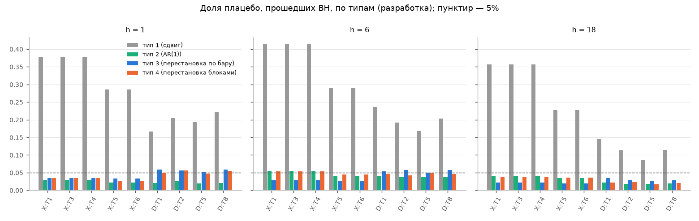
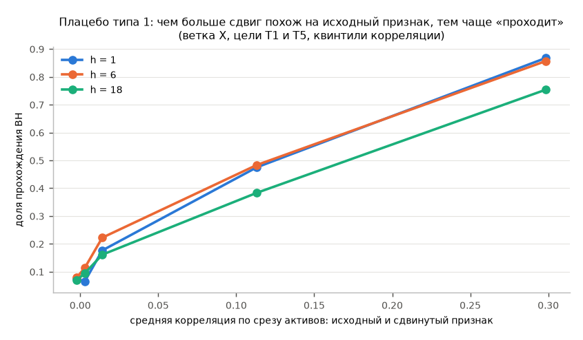

# Q2. Правильное плацебо и роль поправки BH

Разработка, те же 40 помесячных переобучений, что в F2 (контроль в Q2 не используется). На каждом переобучении 890
реальных признаков F2 оценивались заново тем же кодом F2 вместе со свежими плацебо — 20% от числа реальных, поровну 4 типа:

- **тип 1** — сдвиг по времени ≥ 60 суток (как в F2; только для демонстрации, в итоговый FDR не входит);
- **тип 2** — шум AR(1), φ ∈ {0,5; 0,9; 0,98} (как в F2);
- **тип 3** — **перестановочное плацебо**: реальный признак, значения которого на каждом баре случайно переставлены между активами
  (распределение по срезу сохраняется, связь с конкретным активом ломается);
- **тип 4** — то же, но одна перестановка на блок 30 суток (сохраняет память признака во времени).

Для ветки D перестановка делается так же по барам; но там признак оценивается одной корреляцией по пулу (время × актив) с
блочным бутстрепом, поэтому перестановка между активами может вести себя иначе, чем в ветке X (по срезу активов).

## Вывод

- «Отбор контролирует ложные находки» (режим (а), доля плацебо типов 3+4 среди отобранных ≤ 10% во всех парах): **да** (максимум 0.7%).
- «BH сама по себе контролирует» (режим (в) ≤ 10% во всех парах): **да** (максимум 1.6%; BH оставляет в среднем 532 признаков из ~1070 на переобучение).
- Типы 3 и 4 проходят BH до 5.9% (максимум по парам), тип 1 — в среднем 26.3%.
- t-статистика при лаге Ньюи–Уэста = h **завышена** для медленного шума (φ = 0,98): h=1 (T1/T3/T4): доля |t|>2 при лаге h = 4.2%; к номиналу возвращает лаг 1h = 1; h=1 (T5/T6): доля |t|>2 при лаге h = 3.3%; к номиналу возвращает лаг 1h = 1; h=6 (T1/T3/T4): доля |t|>2 при лаге h = 9.7%; ни один лаг до 4h не возвращает к номиналу; h=6 (T5/T6): доля |t|>2 при лаге h = 6.0%; к номиналу возвращает лаг 1h = 6; h=18 (T1/T3/T4): доля |t|>2 при лаге h = 10.8%; к номиналу возвращает лаг 4h = 72; h=18 (T5/T6): доля |t|>2 при лаге h = 9.0%; к номиналу возвращает лаг 2h = 36.

## Доля прохождения BH по типам

`real` — реальные признаки. Все плацебо и реальные признаки проходят BH вместе, как в F2.

| branch | target | h | bh_pass_real | bh_pass_t1 | bh_pass_t2 | bh_pass_t3 | bh_pass_t4 |
|---|---|---|---|---|---|---|---|
| X | T1 | 1 | 0.819 | 0.378 | 0.03 | 0.035 | 0.035 |
| X | T1 | 6 | 0.736 | 0.413 | 0.054 | 0.029 | 0.053 |
| X | T1 | 18 | 0.534 | 0.357 | 0.041 | 0.022 | 0.038 |
| X | T3 | 1 | 0.819 | 0.378 | 0.03 | 0.035 | 0.035 |
| X | T3 | 6 | 0.736 | 0.413 | 0.054 | 0.029 | 0.053 |
| X | T3 | 18 | 0.534 | 0.357 | 0.041 | 0.022 | 0.038 |
| X | T4 | 1 | 0.819 | 0.378 | 0.03 | 0.035 | 0.035 |
| X | T4 | 6 | 0.736 | 0.413 | 0.054 | 0.029 | 0.053 |
| X | T4 | 18 | 0.534 | 0.357 | 0.041 | 0.022 | 0.038 |
| X | T5 | 1 | 0.78 | 0.285 | 0.022 | 0.033 | 0.027 |
| X | T5 | 6 | 0.664 | 0.289 | 0.041 | 0.026 | 0.045 |
| X | T5 | 18 | 0.462 | 0.228 | 0.035 | 0.019 | 0.036 |
| X | T6 | 1 | 0.78 | 0.285 | 0.022 | 0.033 | 0.027 |
| X | T6 | 6 | 0.664 | 0.289 | 0.041 | 0.026 | 0.045 |
| X | T6 | 18 | 0.462 | 0.228 | 0.035 | 0.019 | 0.036 |
| D | T1 | 1 | 0.695 | 0.167 | 0.021 | 0.059 | 0.048 |
| D | T1 | 6 | 0.509 | 0.236 | 0.041 | 0.053 | 0.046 |
| D | T1 | 18 | 0.226 | 0.144 | 0.022 | 0.035 | 0.022 |
| D | T2 | 1 | 0.673 | 0.205 | 0.026 | 0.056 | 0.056 |
| D | T2 | 6 | 0.519 | 0.192 | 0.037 | 0.058 | 0.043 |
| D | T2 | 18 | 0.209 | 0.114 | 0.018 | 0.029 | 0.023 |
| D | T5 | 1 | 0.676 | 0.193 | 0.02 | 0.052 | 0.047 |
| D | T5 | 6 | 0.471 | 0.167 | 0.037 | 0.049 | 0.048 |
| D | T5 | 18 | 0.129 | 0.085 | 0.018 | 0.026 | 0.017 |
| D | T8 | 1 | 0.697 | 0.221 | 0.021 | 0.059 | 0.055 |
| D | T8 | 6 | 0.518 | 0.203 | 0.038 | 0.057 | 0.046 |
| D | T8 | 18 | 0.216 | 0.115 | 0.02 | 0.029 | 0.021 |

## Доля плацебо среди отобранных при четырёх режимах

`fdr34_*` — доля плацебо **типов 3 и 4** среди отобранных; режимы: (а) `bh_top20` — BH + не более 20 по |t| (как в F2);
(б) `top20_only` — 20 лучших по |t| без BH; (в) `bh_only` — все прошедшие BH; (г) `naive_t2` — |t| > 2.
`fdr234_bh_only` — то же для типов 2+3+4 в режиме (в). `bh_only_selected_per_refit` — сколько признаков (реальных и плацебо) в среднем
проходит BH на одно переобучение (из ~1070). Плацебо типов 3+4 составляют ~8.3% всех проверяемых признаков,
поэтому доля среди отобранных сравнима с этим числом «при полной слепоте» отбора.

| branch | target | h | fdr34_bh_top20 | fdr34_top20_only | fdr34_bh_only | fdr34_naive_t2 | fdr234_bh_only | bh_only_selected_per_refit |
|---|---|---|---|---|---|---|---|---|
| X | T1 | 1 | 0 | 0 | 0.004 | 0.005 | 0.006 | 750.6 |
| X | T1 | 6 | 0 | 0 | 0.005 | 0.007 | 0.009 | 679.8 |
| X | T1 | 18 | 0 | 0 | 0.005 | 0.009 | 0.009 | 495.6 |
| X | T3 | 1 | 0 | 0 | 0.004 | 0.005 | 0.006 | 750.6 |
| X | T3 | 6 | 0 | 0 | 0.005 | 0.007 | 0.009 | 679.8 |
| X | T3 | 18 | 0 | 0 | 0.005 | 0.009 | 0.009 | 495.6 |
| X | T4 | 1 | 0 | 0 | 0.004 | 0.005 | 0.006 | 750.6 |
| X | T4 | 6 | 0 | 0 | 0.005 | 0.007 | 0.009 | 679.8 |
| X | T4 | 18 | 0 | 0 | 0.005 | 0.009 | 0.009 | 495.6 |
| X | T5 | 1 | 0 | 0 | 0.004 | 0.005 | 0.005 | 711 |
| X | T5 | 6 | 0 | 0 | 0.005 | 0.008 | 0.008 | 609.2 |
| X | T5 | 18 | 0 | 0 | 0.006 | 0.01 | 0.009 | 425.7 |
| X | T6 | 1 | 0 | 0 | 0.004 | 0.005 | 0.005 | 711 |
| X | T6 | 6 | 0 | 0 | 0.005 | 0.008 | 0.008 | 609.2 |
| X | T6 | 18 | 0 | 0 | 0.006 | 0.01 | 0.009 | 425.7 |
| D | T1 | 1 | 0 | 0 | 0.007 | 0.009 | 0.009 | 631.7 |
| D | T1 | 6 | 0 | 0 | 0.009 | 0.015 | 0.013 | 469.9 |
| D | T1 | 18 | 0 | 0 | 0.012 | 0.025 | 0.017 | 211.2 |
| D | T2 | 1 | 0 | 0 | 0.008 | 0.011 | 0.01 | 613.9 |
| D | T2 | 6 | 0 | 0 | 0.009 | 0.015 | 0.013 | 476.8 |
| D | T2 | 18 | 0.003 | 0.002 | 0.012 | 0.02 | 0.016 | 194.2 |
| D | T5 | 1 | 0 | 0 | 0.007 | 0.01 | 0.009 | 615.7 |
| D | T5 | 6 | 0 | 0 | 0.01 | 0.016 | 0.014 | 432.7 |
| D | T5 | 18 | 0.007 | 0.009 | 0.016 | 0.028 | 0.022 | 121.7 |
| D | T8 | 1 | 0 | 0 | 0.008 | 0.011 | 0.009 | 635.9 |
| D | T8 | 6 | 0 | 0 | 0.01 | 0.014 | 0.013 | 476.7 |
| D | T8 | 18 | 0.003 | 0.002 | 0.011 | 0.02 | 0.015 | 200.4 |

## Калибровка t-статистики (ветка X, плацебо типа 2 с φ = 0,98)

Номинальная доля |t| > 2 для честного теста — 4,6%. `se` — стандартная ошибка доли при номинале.

| h | target_class | nw_lag | share_abs_t_gt_2 | n | se |
|---|---|---|---|---|---|
| 1 | T1/T3/T4 | 1h = 1 | 0.0417 | 600 | 0.0086 |
| 1 | T1/T3/T4 | 2h = 2 | 0.0517 | 600 | 0.0086 |
| 1 | T1/T3/T4 | 4h = 4 | 0.0567 | 600 | 0.0086 |
| 1 | T5/T6 | 1h = 1 | 0.0333 | 600 | 0.0086 |
| 1 | T5/T6 | 2h = 2 | 0.04 | 600 | 0.0086 |
| 1 | T5/T6 | 4h = 4 | 0.0433 | 600 | 0.0086 |
| 6 | T1/T3/T4 | 1h = 6 | 0.0967 | 600 | 0.0086 |
| 6 | T1/T3/T4 | 2h = 12 | 0.0767 | 600 | 0.0086 |
| 6 | T1/T3/T4 | 4h = 24 | 0.0667 | 600 | 0.0086 |
| 6 | T5/T6 | 1h = 6 | 0.06 | 600 | 0.0086 |
| 6 | T5/T6 | 2h = 12 | 0.0417 | 600 | 0.0086 |
| 6 | T5/T6 | 4h = 24 | 0.0383 | 600 | 0.0086 |
| 18 | T1/T3/T4 | 1h = 18 | 0.1083 | 600 | 0.0086 |
| 18 | T1/T3/T4 | 2h = 36 | 0.0717 | 600 | 0.0086 |
| 18 | T1/T3/T4 | 4h = 72 | 0.0617 | 600 | 0.0086 |
| 18 | T5/T6 | 1h = 18 | 0.09 | 600 | 0.0086 |
| 18 | T5/T6 | 2h = 36 | 0.0583 | 600 | 0.0086 |
| 18 | T5/T6 | 4h = 72 | 0.0533 | 600 | 0.0086 |

## Тип 1: почему сдвиг по времени «проходит»

Для каждого сдвинутого признака — средняя по барам корреляция Спирмена по срезу активов между исходным и сдвинутым значением
на обучающем окне; ниже — доля прохождения BH по квинтилям этой корреляции (ветка X, цели T1 и T5, все переобучения).
Средняя корреляция: 0.09; доля сдвигов с корреляцией > 0,3: 9.9%.

| h | corr_bin | n | pass_rate | corr_mid |
|---|---|---|---|---|
| 1 | (-0.0526, 0.000555] | 720 | 0.074 | -0.002 |
| 1 | (0.000555, 0.00681] | 720 | 0.065 | 0.003 |
| 1 | (0.00681, 0.048] | 720 | 0.176 | 0.014 |
| 1 | (0.048, 0.178] | 720 | 0.475 | 0.113 |
| 1 | (0.178, 0.623] | 720 | 0.868 | 0.299 |
| 6 | (-0.0526, 0.000555] | 720 | 0.079 | -0.002 |
| 6 | (0.000555, 0.00681] | 720 | 0.114 | 0.003 |
| 6 | (0.00681, 0.048] | 720 | 0.222 | 0.014 |
| 6 | (0.048, 0.178] | 720 | 0.483 | 0.113 |
| 6 | (0.178, 0.623] | 720 | 0.857 | 0.299 |
| 18 | (-0.0526, 0.000555] | 720 | 0.069 | -0.002 |
| 18 | (0.000555, 0.00681] | 720 | 0.094 | 0.003 |
| 18 | (0.00681, 0.048] | 720 | 0.161 | 0.014 |
| 18 | (0.048, 0.178] | 720 | 0.383 | 0.113 |
| 18 | (0.178, 0.623] | 720 | 0.754 | 0.299 |

Оговорка: Q2 считается только на разработке; контроль уже открывался в F2: подтверждаем только знак и порядок величины — здесь не применяется.
