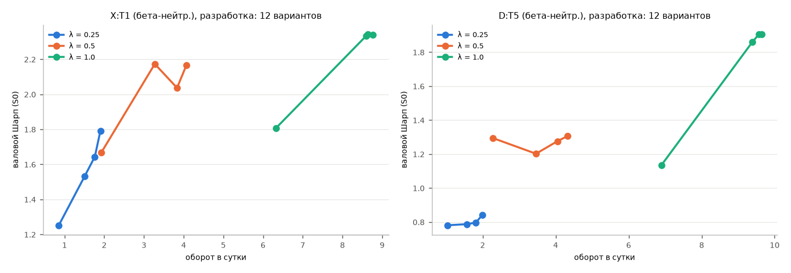

# Q4. Одна попытка снизить оборот: зона без сделок с частичным движением

**Зона без сделок (no-trade band)** — позиция актива меняется, только если целевой вес отличается от текущего больше порога `b`;
тогда позиция сдвигается к цели на долю `λ` разницы. Сетка заморожена: b ∈ {0; 0,25; 0,5; 1} × медианное |Δw| стратегии
(ненулевые изменения на разработке), λ ∈ {0,25; 0,5; 1} — 12 вариантов. Объекты — две лучшие по валовому Шарпу (M, разработка)
стратегии h = 1 в бета-нейтральной версии (Q3). Выбор — по чистому Шарпу S1 на разработке, записан в `logs/attempts_F2b.csv` и
`data/work/f2b/q4_selected.json` до расчёта на контроле.

## Вывод (правило заморожено)

**закрыть.** Максимальный EPT на сетке (разработка): **4.31 б.п.** — в **1.5 раза** ниже цены
одной стороны сделки в S1 (6,5 б.п.). Точка безубыточности по издержкам на сторону для выбранного варианта (разработка) равна его EPT:
X:T1: 4.31 б.п., D:T5: 3.01 б.п..

**Оговорка о контроле.** У X:T1 (оборот 0.042 против 0.855 в сутки на разработке) на контроле позиции почти не меняются: порог зоны задан в единицах медианного |Δw| разработки, а на контроле активов больше и веса мельче, поэтому изменения цели почти всегда меньше порога. Высокий EPT на контроле здесь — результат почти статичного портфеля, а не сигнала; решение принимается по разработке.

## Выбранные варианты

| strategy | period | band_mult | lam | sharpe_S0 | sharpe_S1 | S1_ci_lo | S1_ci_hi | sharpe_S2 | turnover_day | ept_bp | ccr | breakeven_cost_side_bp |
|---|---|---|---|---|---|---|---|---|---|---|---|---|
| X:T1 | dev | 1 | 0.25 | 1.252 | -0.636 | -1.501 | 0.271 | 0.017 | 0.855 | 4.308 | 0.663 | 4.308 |
| X:T1 | holdout | 1 | 0.25 | 1.123 | 0.991 | -1.695 | 2.904 | 1.036 | 0.042 | 55.37 | 8.518 | 55.37 |
| D:T5 | dev | 1 | 0.25 | 0.781 | -0.903 | -1.733 | -0.057 | -0.32 | 1.036 | 3.014 | 0.464 | 3.014 |
| D:T5 | holdout | 1 | 0.25 | 0.979 | 0.186 | -2.532 | 2.555 | 0.461 | 0.445 | 8.026 | 1.235 | 8.026 |

## Все 12 вариантов (разработка)

| strategy | band_mult | lam | turnover_day | gross_sharpe_S0 | net_sharpe_S1 | ept_bp |
|---|---|---|---|---|---|---|
| X:T1 | 0 | 0.25 | 1.903 | 1.791 | -2.846 | 2.512 |
| X:T1 | 0 | 0.5 | 4.066 | 2.165 | -5.307 | 1.887 |
| X:T1 | 0 | 1 | 8.768 | 2.341 | -8.419 | 1.422 |
| X:T1 | 0.25 | 0.25 | 1.763 | 1.644 | -2.298 | 2.711 |
| X:T1 | 0.25 | 0.5 | 3.834 | 2.037 | -4.653 | 1.982 |
| X:T1 | 0.25 | 1 | 8.641 | 2.343 | -8.202 | 1.453 |
| X:T1 | 0.5 | 0.25 | 1.508 | 1.533 | -1.179 | 3.675 |
| X:T1 | 0.5 | 0.5 | 3.273 | 2.173 | -2.851 | 2.813 |
| X:T1 | 0.5 | 1 | 8.594 | 2.333 | -8.099 | 1.463 |
| X:T1 | 1 | 0.25 | 0.855 | 1.252 | -0.636 | 4.308 |
| X:T1 | 1 | 0.5 | 1.924 | 1.667 | -1.422 | 3.508 |
| X:T1 | 1 | 1 | 6.322 | 1.806 | -4.85 | 1.754 |
| D:T5 | 0 | 0.25 | 1.986 | 0.841 | -3.318 | 1.316 |
| D:T5 | 0 | 0.5 | 4.318 | 1.306 | -5.177 | 1.312 |
| D:T5 | 0 | 1 | 9.642 | 1.904 | -7.351 | 1.346 |
| D:T5 | 0.25 | 0.25 | 1.815 | 0.797 | -2.822 | 1.432 |
| D:T5 | 0.25 | 0.5 | 4.046 | 1.276 | -4.595 | 1.416 |
| D:T5 | 0.25 | 1 | 9.567 | 1.906 | -7.33 | 1.35 |
| D:T5 | 0.5 | 0.25 | 1.565 | 0.788 | -2.012 | 1.83 |
| D:T5 | 0.5 | 0.5 | 3.462 | 1.202 | -3.494 | 1.667 |
| D:T5 | 0.5 | 1 | 9.389 | 1.86 | -7.24 | 1.337 |
| D:T5 | 1 | 0.25 | 1.036 | 0.781 | -0.903 | 3.014 |
| D:T5 | 1 | 0.5 | 2.276 | 1.295 | -1.501 | 3.012 |
| D:T5 | 1 | 1 | 6.899 | 1.135 | -4.587 | 1.292 |

Оговорка: контроль уже открывался в F2: подтверждаем только знак и порядок величины.
