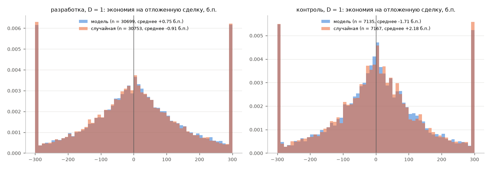

# Q5. Сигнал как подсказка, когда совершать вынужденные сделки

Синтетическая модель (заморожена): для каждого актива и бара с вероятностью 1/6 возникает вынужденная сделка, направление случайное
(генератор с фиксированным зерном 20261025). Базовое исполнение — по марк-цене открытия следующего бара. С подсказкой сделку
можно отложить не более чем на D баров: если прогноз ветки D (лучшая по валовому Шарпу на разработке, вариант M: **D:T5**, h = 1,
z-оценка) говорит, что ближайший бар сдвинет цену в нашу пользу сильнее порога θ, сделка откладывается на бар (и так далее до D).
θ выбран на разработке из {0; 0,5; 1} отдельно для каждого D: D=1: θ=0.0, D=2: θ=1.0.
Учитываются только бары, где есть внешневыборочный прогноз. Экономия — в б.п. от базовой цены, со знаком (покупка дешевле / продажа дороже — плюс).
Случайная подсказка откладывает с той же частотой, но случайно. Интервалы — 90%, блочный бутстреп по дням (блок 7 суток).

## Вывод (правило заморожено: нижняя граница > 0 на разработке и контроле, случайная подсказка — интервал включает 0; принято для обоих D)

**пользы для тайминга не обнаружено.** По D: D=1: нет, D=2: нет.

| period | D | theta | hint | trades | postponed_share | mean_saving_bp | ci_lo | ci_hi | helped_share_of_postponed | p5_saving_postponed_bp |
|---|---|---|---|---|---|---|---|---|---|---|
| dev | 1 | 0 | модель | 61280 | 0.501 | 0.374 | -0.844 | 1.499 | 0.505 | -325.2 |
| dev | 1 | 0 | случайная | 61280 | 0.502 | -0.457 | -1.506 | 0.565 | 0.496 | -331.1 |
| holdout | 1 | 0 | модель | 14186 | 0.503 | -0.861 | -2.671 | 1.062 | 0.507 | -307.5 |
| holdout | 1 | 0 | случайная | 14186 | 0.505 | 1.099 | -0.83 | 2.938 | 0.511 | -306.8 |
| dev | 2 | 1 | модель | 61280 | 0.169 | 0.775 | 0.097 | 1.394 | 0.534 | -392.3 |
| dev | 2 | 1 | случайная | 61280 | 0.175 | 0.248 | -0.386 | 0.862 | 0.506 | -350.9 |
| holdout | 2 | 1 | модель | 14186 | 0.162 | -0.081 | -1.601 | 1.499 | 0.541 | -392.9 |
| holdout | 2 | 1 | случайная | 14186 | 0.169 | 0.351 | -1.071 | 1.815 | 0.504 | -336.3 |

Данных F1 о реальных входах и выходах carry нет (`doc_check_F2b.md`, п. 4), справочный расчёт на них не делался.

Оговорки: модель вынужденных сделок синтетическая; влияние объёма на цену не учтено; контроль уже открывался в F2: подтверждаем только знак и порядок величины.
