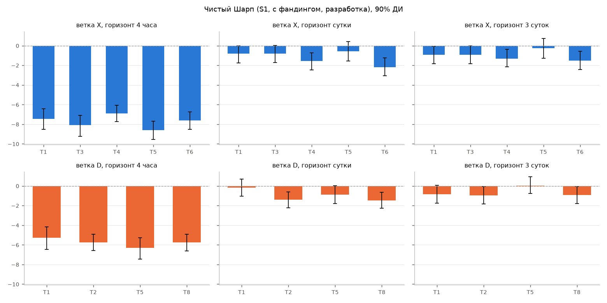
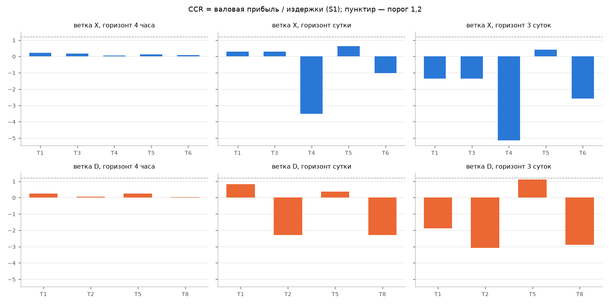
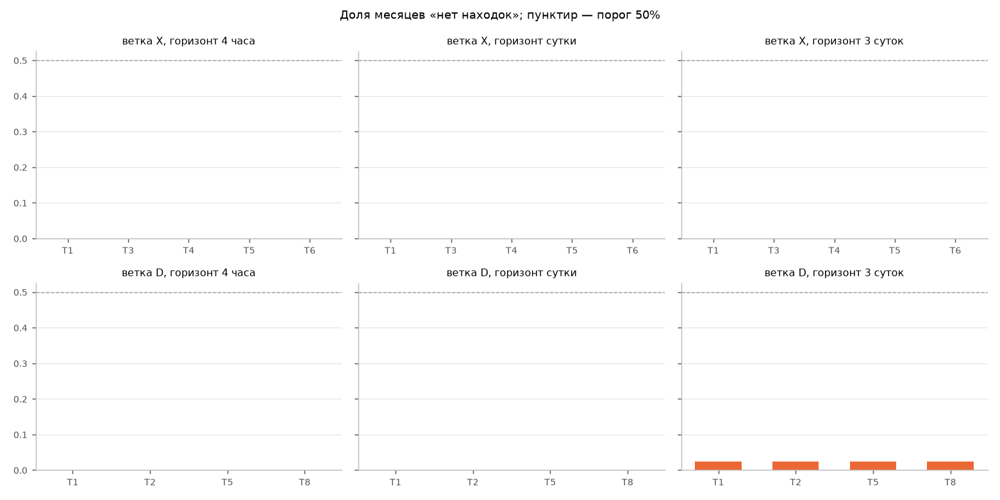

# Сравнение целей прогноза: деньги после издержек

Портфели: ветка X — длинные верхние 20% и короткие нижние 20% активов по оценке модели, равные веса; ветка D — по каждому
активу +1/−1/0 по порогу θ на z-оценке (θ выбран на разработке, `logs/theta_selected_F2.json`). Пересчёт раз в h баров,
вход по открытию следующего бара. Доходность — на валовой объём (сумма модулей весов = 1). Издержки начисляются на
каждое изменение позиции. Фандинг — по расчётным ставкам, стоимость позиции ≈ вес. `beta` — бета к равновзвешенному рынку.
`ann_ret` — годовая чистая доходность на валовой объём; `mdd` — максимальная просадка (в долях валового объёма, сумма дневных доходностей).

Основное доказательство — объединённые внешневыборочные результаты walk-forward на разработке
(1209 дней); контроль (180 дней) — проверка знака и порядка величины.

**Проскальзывание 1 б.п.** Половина медианного L1-спреда по записям Stage 4 (48 ч, 80 символов): медиана по символам
0.64 б.п., 90-й перцентиль 1.94 б.п., максимум 6.77 б.п. Это нижняя оценка
стоимости пересечения спреда для малого объёма; принятый 1 б.п. её покрывает для большинства символов (влияние объёма на цену не учтено).

## Метрики

### dev, S1, с фандингом

| branch | target | h | ann_ret | sharpe | mdd | turnover_day | cost_day | ccr | pos_months | oos_ic | no_find | beta | jaccard |
|---|---|---|---|---|---|---|---|---|---|---|---|---|---|
| X | T1 | 1 | -1.555 | -7.44 | 5.151 | 8.564 | 0.006 | 0.235 | 0.025 | 0.031 | 0 | -0.025 | 0.887 |
| X | T1 | 6 | -0.187 | -0.82 | 1.02 | 1.127 | 0.001 | 0.299 | 0.35 | 0.034 | 0 | -0.125 | 0.94 |
| X | T1 | 18 | -0.223 | -0.944 | 0.849 | 0.399 | 0 | -1.355 | 0.525 | 0.046 | 0 | -0.148 | 0.826 |
| X | T3 | 1 | -1.686 | -8.104 | 5.585 | 8.613 | 0.006 | 0.175 | 0 | 0.031 | 0 | -0.02 | 0.887 |
| X | T3 | 6 | -0.187 | -0.82 | 1.02 | 1.127 | 0.001 | 0.299 | 0.35 | 0.034 | 0 | -0.125 | 0.94 |
| X | T3 | 18 | -0.223 | -0.944 | 0.849 | 0.399 | 0 | -1.355 | 0.525 | 0.046 | 0 | -0.148 | 0.826 |
| X | T4 | 1 | -1.67 | -6.906 | 5.549 | 7.505 | 0.005 | 0.062 | 0 | 0.051 | 0 | -0.082 | 0.887 |
| X | T4 | 6 | -0.471 | -1.55 | 1.567 | 0.439 | 0 | -3.525 | 0.325 | 0.073 | 0 | -0.281 | 0.94 |
| X | T4 | 18 | -0.372 | -1.31 | 1.261 | 0.255 | 0 | -5.144 | 0.35 | 0.08 | 0 | -0.251 | 0.826 |
| X | T5 | 1 | -1.836 | -8.603 | 6.086 | 8.947 | 0.006 | 0.135 | 0 | 0.033 | 0 | -0.021 | 0.913 |
| X | T5 | 6 | -0.12 | -0.56 | 0.706 | 1.331 | 0.001 | 0.621 | 0.425 | 0.019 | 0 | -0.04 | 0.837 |
| X | T5 | 18 | -0.057 | -0.261 | 0.69 | 0.415 | 0 | 0.418 | 0.45 | 0.032 | 0 | -0.1 | 0.728 |
| X | T6 | 1 | -1.768 | -7.6 | 5.862 | 8.079 | 0.005 | 0.077 | 0.05 | 0.046 | 0 | -0.045 | 0.913 |
| X | T6 | 6 | -0.528 | -2.191 | 1.788 | 1.097 | 0.001 | -1.029 | 0.35 | 0.045 | 0 | -0.169 | 0.837 |
| X | T6 | 18 | -0.34 | -1.528 | 1.13 | 0.399 | 0 | -2.587 | 0.35 | 0.045 | 0 | -0.145 | 0.728 |
| D | T1 | 1 | -1.718 | -5.272 | 5.69 | 9.781 | 0.006 | 0.26 | 0.075 | 0.016 | 0 | -0.039 | 0.639 |
| D | T1 | 6 | -0.052 | -0.178 | 0.655 | 1.206 | 0.001 | 0.82 | 0.525 | 0.018 | 0 | -0.169 | 0.575 |
| D | T1 | 18 | -0.117 | -0.846 | 0.536 | 0.171 | 0 | -1.892 | 0.525 | 0.02 | 0.025 | -0.076 | 0.472 |
| D | T2 | 1 | -1.001 | -5.751 | 3.334 | 4.457 | 0.003 | 0.054 | 0.025 | 0.028 | 0 | 0.046 | 0.563 |
| D | T2 | 6 | -0.221 | -1.401 | 0.799 | 0.284 | 0 | -2.279 | 0.35 | 0.027 | 0 | -0.111 | 0.593 |
| D | T2 | 18 | -0.297 | -0.965 | 1.033 | 0.308 | 0 | -3.073 | 0.375 | 0.024 | 0.025 | -0.208 | 0.524 |
| D | T5 | 1 | -1.699 | -6.321 | 5.633 | 9.55 | 0.006 | 0.25 | 0.075 | 0.015 | 0 | -0.024 | 0.674 |
| D | T5 | 6 | -0.155 | -0.903 | 0.68 | 1.042 | 0.001 | 0.372 | 0.425 | 0.007 | 0 | -0.046 | 0.577 |
| D | T5 | 18 | 0.006 | 0.044 | 0.347 | 0.222 | 0 | 1.122 | 0.6 | 0.017 | 0.025 | -0.081 | 0.416 |
| D | T8 | 1 | -0.974 | -5.768 | 3.264 | 4.263 | 0.003 | 0.037 | 0.05 | 0.029 | 0 | 0.047 | 0.555 |
| D | T8 | 6 | -0.225 | -1.474 | 0.791 | 0.288 | 0 | -2.293 | 0.35 | 0.028 | 0 | -0.104 | 0.596 |
| D | T8 | 18 | -0.283 | -0.917 | 0.981 | 0.306 | 0 | -2.895 | 0.425 | 0.025 | 0.025 | -0.21 | 0.532 |
### dev, S1, без фандинга

| branch | target | h | ann_ret | sharpe | mdd | turnover_day | cost_day | ccr | pos_months | oos_ic | no_find | beta | jaccard |
|---|---|---|---|---|---|---|---|---|---|---|---|---|---|
| X | T1 | 1 | -1.553 | -7.445 | 5.144 | 8.564 | 0.006 | 0.236 | 0.025 | 0.031 | 0 | -0.025 | 0.887 |
| X | T1 | 6 | -0.197 | -0.866 | 1.033 | 1.127 | 0.001 | 0.262 | 0.375 | 0.034 | 0 | -0.125 | 0.94 |
| X | T1 | 18 | -0.221 | -0.938 | 0.858 | 0.399 | 0 | -1.336 | 0.525 | 0.046 | 0 | -0.148 | 0.826 |
| X | T3 | 1 | -1.685 | -8.11 | 5.582 | 8.613 | 0.006 | 0.175 | 0 | 0.031 | 0 | -0.02 | 0.887 |
| X | T3 | 6 | -0.197 | -0.866 | 1.033 | 1.127 | 0.001 | 0.262 | 0.375 | 0.034 | 0 | -0.125 | 0.94 |
| X | T3 | 18 | -0.221 | -0.938 | 0.858 | 0.399 | 0 | -1.336 | 0.525 | 0.046 | 0 | -0.148 | 0.826 |
| X | T4 | 1 | -1.645 | -6.817 | 5.469 | 7.505 | 0.005 | 0.076 | 0 | 0.051 | 0 | -0.082 | 0.887 |
| X | T4 | 6 | -0.448 | -1.478 | 1.49 | 0.439 | 0 | -3.301 | 0.35 | 0.073 | 0 | -0.28 | 0.94 |
| X | T4 | 18 | -0.359 | -1.266 | 1.222 | 0.255 | 0 | -4.927 | 0.375 | 0.08 | 0 | -0.25 | 0.826 |
| X | T5 | 1 | -1.819 | -8.532 | 6.029 | 8.947 | 0.006 | 0.143 | 0 | 0.033 | 0 | -0.021 | 0.913 |
| X | T5 | 6 | -0.121 | -0.568 | 0.703 | 1.331 | 0.001 | 0.617 | 0.375 | 0.019 | 0 | -0.04 | 0.837 |
| X | T5 | 18 | -0.057 | -0.26 | 0.705 | 0.415 | 0 | 0.421 | 0.45 | 0.032 | 0 | -0.1 | 0.728 |
| X | T6 | 1 | -1.745 | -7.514 | 5.786 | 8.079 | 0.005 | 0.089 | 0.05 | 0.046 | 0 | -0.045 | 0.913 |
| X | T6 | 6 | -0.511 | -2.125 | 1.73 | 1.097 | 0.001 | -0.962 | 0.35 | 0.045 | 0 | -0.169 | 0.837 |
| X | T6 | 18 | -0.325 | -1.467 | 1.083 | 0.399 | 0 | -2.436 | 0.35 | 0.045 | 0 | -0.145 | 0.728 |
| D | T1 | 1 | -1.7 | -5.229 | 5.63 | 9.781 | 0.006 | 0.267 | 0.1 | 0.016 | 0 | -0.039 | 0.639 |
| D | T1 | 6 | -0.054 | -0.188 | 0.662 | 1.206 | 0.001 | 0.81 | 0.525 | 0.018 | 0 | -0.169 | 0.575 |
| D | T1 | 18 | -0.113 | -0.816 | 0.529 | 0.171 | 0 | -1.779 | 0.475 | 0.02 | 0.025 | -0.076 | 0.472 |
| D | T2 | 1 | -0.988 | -5.677 | 3.292 | 4.457 | 0.003 | 0.066 | 0.025 | 0.028 | 0 | 0.046 | 0.563 |
| D | T2 | 6 | -0.21 | -1.33 | 0.769 | 0.284 | 0 | -2.107 | 0.4 | 0.027 | 0 | -0.11 | 0.593 |
| D | T2 | 18 | -0.275 | -0.893 | 0.979 | 0.308 | 0 | -2.766 | 0.4 | 0.024 | 0.025 | -0.207 | 0.524 |
| D | T5 | 1 | -1.686 | -6.282 | 5.588 | 9.55 | 0.006 | 0.256 | 0.075 | 0.015 | 0 | -0.023 | 0.674 |
| D | T5 | 6 | -0.163 | -0.953 | 0.689 | 1.042 | 0.001 | 0.339 | 0.375 | 0.007 | 0 | -0.046 | 0.577 |
| D | T5 | 18 | 0.011 | 0.072 | 0.341 | 0.222 | 0 | 1.201 | 0.575 | 0.017 | 0.025 | -0.081 | 0.416 |
| D | T8 | 1 | -0.959 | -5.681 | 3.216 | 4.263 | 0.003 | 0.051 | 0.075 | 0.029 | 0 | 0.048 | 0.555 |
| D | T8 | 6 | -0.212 | -1.395 | 0.758 | 0.288 | 0 | -2.111 | 0.375 | 0.028 | 0 | -0.104 | 0.596 |
| D | T8 | 18 | -0.26 | -0.844 | 0.927 | 0.306 | 0 | -2.583 | 0.45 | 0.025 | 0.025 | -0.21 | 0.532 |
### dev, S2, с фандингом

| branch | target | h | ann_ret | sharpe | mdd | turnover_day | cost_day | ccr | pos_months | oos_ic | no_find | beta | jaccard |
|---|---|---|---|---|---|---|---|---|---|---|---|---|---|
| X | T1 | 1 | -0.852 | -4.064 | 2.833 | 8.564 | 0.004 | 0.235 | 0.1 | 0.031 | 0 | -0.025 | 0.887 |
| X | T1 | 6 | -0.095 | -0.415 | 0.847 | 1.127 | 0 | 0.299 | 0.425 | 0.034 | 0 | -0.125 | 0.94 |
| X | T1 | 18 | -0.19 | -0.805 | 0.785 | 0.399 | 0 | -1.355 | 0.525 | 0.046 | 0 | -0.148 | 0.826 |
| X | T3 | 1 | -0.979 | -4.687 | 3.241 | 8.613 | 0.004 | 0.175 | 0.075 | 0.031 | 0 | -0.02 | 0.887 |
| X | T3 | 6 | -0.095 | -0.415 | 0.847 | 1.127 | 0 | 0.299 | 0.425 | 0.034 | 0 | -0.125 | 0.94 |
| X | T3 | 18 | -0.19 | -0.805 | 0.785 | 0.399 | 0 | -1.355 | 0.525 | 0.046 | 0 | -0.148 | 0.826 |
| X | T4 | 1 | -1.053 | -4.337 | 3.543 | 7.505 | 0.003 | 0.062 | 0.125 | 0.051 | 0 | -0.082 | 0.887 |
| X | T4 | 6 | -0.435 | -1.431 | 1.448 | 0.439 | 0 | -3.525 | 0.35 | 0.073 | 0 | -0.281 | 0.94 |
| X | T4 | 18 | -0.351 | -1.236 | 1.192 | 0.255 | 0 | -5.144 | 0.375 | 0.08 | 0 | -0.251 | 0.826 |
| X | T5 | 1 | -1.101 | -5.136 | 3.686 | 8.947 | 0.004 | 0.135 | 0.05 | 0.033 | 0 | -0.021 | 0.913 |
| X | T5 | 6 | -0.01 | -0.048 | 0.507 | 1.331 | 0.001 | 0.621 | 0.475 | 0.019 | 0 | -0.04 | 0.837 |
| X | T5 | 18 | -0.023 | -0.106 | 0.63 | 0.415 | 0 | 0.418 | 0.45 | 0.032 | 0 | -0.1 | 0.728 |
| X | T6 | 1 | -1.105 | -4.726 | 3.693 | 8.079 | 0.003 | 0.077 | 0.15 | 0.046 | 0 | -0.046 | 0.913 |
| X | T6 | 6 | -0.438 | -1.816 | 1.497 | 1.097 | 0 | -1.029 | 0.35 | 0.045 | 0 | -0.169 | 0.837 |
| X | T6 | 18 | -0.307 | -1.381 | 1.033 | 0.399 | 0 | -2.587 | 0.35 | 0.045 | 0 | -0.145 | 0.728 |
| D | T1 | 1 | -0.914 | -2.8 | 3.077 | 9.781 | 0.004 | 0.26 | 0.3 | 0.016 | 0 | -0.039 | 0.639 |
| D | T1 | 6 | 0.048 | 0.164 | 0.52 | 1.206 | 0.001 | 0.82 | 0.55 | 0.018 | 0 | -0.169 | 0.575 |
| D | T1 | 18 | -0.103 | -0.745 | 0.498 | 0.171 | 0 | -1.892 | 0.525 | 0.02 | 0.025 | -0.076 | 0.472 |
| D | T2 | 1 | -0.635 | -3.637 | 2.146 | 4.457 | 0.002 | 0.054 | 0.075 | 0.028 | 0 | 0.046 | 0.563 |
| D | T2 | 6 | -0.198 | -1.253 | 0.738 | 0.284 | 0 | -2.279 | 0.4 | 0.027 | 0 | -0.111 | 0.593 |
| D | T2 | 18 | -0.272 | -0.883 | 0.958 | 0.308 | 0 | -3.073 | 0.375 | 0.024 | 0.025 | -0.208 | 0.524 |
| D | T5 | 1 | -0.915 | -3.393 | 3.07 | 9.55 | 0.004 | 0.25 | 0.225 | 0.015 | 0 | -0.023 | 0.674 |
| D | T5 | 6 | -0.07 | -0.405 | 0.49 | 1.042 | 0 | 0.372 | 0.525 | 0.007 | 0 | -0.046 | 0.577 |
| D | T5 | 18 | 0.025 | 0.167 | 0.306 | 0.222 | 0 | 1.122 | 0.625 | 0.017 | 0.025 | -0.081 | 0.416 |
| D | T8 | 1 | -0.624 | -3.684 | 2.131 | 4.263 | 0.002 | 0.037 | 0.15 | 0.029 | 0 | 0.048 | 0.555 |
| D | T8 | 6 | -0.201 | -1.319 | 0.73 | 0.288 | 0 | -2.293 | 0.375 | 0.028 | 0 | -0.104 | 0.596 |
| D | T8 | 18 | -0.257 | -0.835 | 0.909 | 0.306 | 0 | -2.895 | 0.425 | 0.025 | 0.025 | -0.21 | 0.532 |
### dev, S0, с фандингом

| branch | target | h | ann_ret | sharpe | mdd | turnover_day | cost_day | ccr | pos_months | oos_ic | no_find | beta | jaccard |
|---|---|---|---|---|---|---|---|---|---|---|---|---|---|
| X | T1 | 1 | 0.477 | 2.261 | 0.158 | 8.564 | 0 | 0.235 | 0.75 | 0.031 | 0 | -0.025 | 0.887 |
| X | T1 | 6 | 0.08 | 0.35 | 0.521 | 1.127 | 0 | 0.299 | 0.575 | 0.034 | 0 | -0.125 | 0.94 |
| X | T1 | 18 | -0.128 | -0.543 | 0.685 | 0.399 | 0 | -1.355 | 0.525 | 0.046 | 0 | -0.148 | 0.826 |
| X | T3 | 1 | 0.357 | 1.7 | 0.3 | 8.613 | 0 | 0.175 | 0.7 | 0.031 | 0 | -0.02 | 0.887 |
| X | T3 | 6 | 0.08 | 0.35 | 0.521 | 1.127 | 0 | 0.299 | 0.575 | 0.034 | 0 | -0.125 | 0.94 |
| X | T3 | 18 | -0.128 | -0.543 | 0.685 | 0.399 | 0 | -1.355 | 0.525 | 0.046 | 0 | -0.148 | 0.826 |
| X | T4 | 1 | 0.111 | 0.453 | 0.53 | 7.505 | 0 | 0.062 | 0.55 | 0.051 | 0 | -0.082 | 0.887 |
| X | T4 | 6 | -0.367 | -1.208 | 1.224 | 0.439 | 0 | -3.525 | 0.4 | 0.073 | 0 | -0.281 | 0.94 |
| X | T4 | 18 | -0.312 | -1.097 | 1.063 | 0.255 | 0 | -5.144 | 0.375 | 0.08 | 0 | -0.251 | 0.826 |
| X | T5 | 1 | 0.287 | 1.326 | 0.207 | 8.947 | 0 | 0.135 | 0.625 | 0.033 | 0 | -0.02 | 0.913 |
| X | T5 | 6 | 0.196 | 0.917 | 0.29 | 1.331 | 0 | 0.621 | 0.65 | 0.019 | 0 | -0.04 | 0.837 |
| X | T5 | 18 | 0.041 | 0.187 | 0.516 | 0.415 | 0 | 0.418 | 0.525 | 0.032 | 0 | -0.1 | 0.728 |
| X | T6 | 1 | 0.148 | 0.629 | 0.622 | 8.079 | 0 | 0.077 | 0.55 | 0.046 | 0 | -0.046 | 0.913 |
| X | T6 | 6 | -0.268 | -1.11 | 0.992 | 1.097 | 0 | -1.029 | 0.45 | 0.045 | 0 | -0.169 | 0.837 |
| X | T6 | 18 | -0.245 | -1.102 | 0.877 | 0.399 | 0 | -2.587 | 0.375 | 0.045 | 0 | -0.146 | 0.728 |
| D | T1 | 1 | 0.603 | 1.837 | 0.355 | 9.781 | 0 | 0.26 | 0.625 | 0.016 | 0 | -0.039 | 0.639 |
| D | T1 | 6 | 0.235 | 0.811 | 0.422 | 1.206 | 0 | 0.82 | 0.625 | 0.018 | 0 | -0.169 | 0.575 |
| D | T1 | 18 | -0.077 | -0.554 | 0.429 | 0.171 | 0 | -1.892 | 0.575 | 0.02 | 0.025 | -0.076 | 0.472 |
| D | T2 | 1 | 0.057 | 0.323 | 0.279 | 4.457 | 0 | 0.054 | 0.55 | 0.028 | 0 | 0.046 | 0.563 |
| D | T2 | 6 | -0.154 | -0.974 | 0.623 | 0.284 | 0 | -2.279 | 0.4 | 0.027 | 0 | -0.111 | 0.593 |
| D | T2 | 18 | -0.224 | -0.728 | 0.817 | 0.308 | 0 | -3.073 | 0.4 | 0.024 | 0.025 | -0.208 | 0.524 |
| D | T5 | 1 | 0.566 | 2.087 | 0.251 | 9.55 | 0 | 0.25 | 0.625 | 0.015 | 0 | -0.023 | 0.674 |
| D | T5 | 6 | 0.092 | 0.535 | 0.224 | 1.042 | 0 | 0.372 | 0.6 | 0.007 | 0 | -0.046 | 0.577 |
| D | T5 | 18 | 0.059 | 0.4 | 0.271 | 0.222 | 0 | 1.122 | 0.65 | 0.017 | 0.025 | -0.082 | 0.416 |
| D | T8 | 1 | 0.037 | 0.217 | 0.343 | 4.263 | 0 | 0.037 | 0.5 | 0.029 | 0 | 0.048 | 0.555 |
| D | T8 | 6 | -0.156 | -1.027 | 0.615 | 0.288 | 0 | -2.293 | 0.425 | 0.028 | 0 | -0.104 | 0.596 |
| D | T8 | 18 | -0.21 | -0.681 | 0.79 | 0.306 | 0 | -2.895 | 0.45 | 0.025 | 0.025 | -0.21 | 0.532 |
### holdout, S1, с фандингом

| branch | target | h | ann_ret | sharpe | mdd | turnover_day | cost_day | ccr | pos_months | oos_ic | no_find | beta | jaccard |
|---|---|---|---|---|---|---|---|---|---|---|---|---|---|
| X | T1 | 1 | -1.306 | -5.965 | 0.698 | 8.189 | 0.005 | 0.328 | 0.143 | 0.031 | 0 | -0.009 | 0.922 |
| X | T1 | 6 | -0.221 | -0.865 | 0.203 | 0.969 | 0.001 | 0.037 | 0.143 | 0.019 | 0 | -0.221 | 0.952 |
| X | T1 | 18 | -0.278 | -1.148 | 0.242 | 0.413 | 0 | -1.84 | 0.286 | 0.02 | 0 | -0.234 | 0.952 |
| X | T3 | 1 | -1.523 | -6.601 | 0.808 | 8.257 | 0.005 | 0.222 | 0.143 | 0.032 | 0 | 0.007 | 0.922 |
| X | T3 | 6 | -0.221 | -0.865 | 0.203 | 0.969 | 0.001 | 0.037 | 0.143 | 0.019 | 0 | -0.221 | 0.952 |
| X | T3 | 18 | -0.278 | -1.148 | 0.242 | 0.413 | 0 | -1.84 | 0.286 | 0.02 | 0 | -0.234 | 0.952 |
| X | T4 | 1 | -1.548 | -6.184 | 0.845 | 7.089 | 0.005 | 0.08 | 0 | 0.053 | 0 | -0.067 | 0.922 |
| X | T4 | 6 | -1.07 | -3.24 | 0.654 | 0.44 | 0 | -9.253 | 0.143 | 0.037 | 0 | -0.425 | 0.952 |
| X | T4 | 18 | -0.899 | -2.957 | 0.529 | 0.247 | 0 | -14.32 | 0.286 | 0.028 | 0 | -0.425 | 0.952 |
| X | T5 | 1 | -1.175 | -4.611 | 0.649 | 8.642 | 0.006 | 0.427 | 0.143 | 0.039 | 0 | -0.003 | 1 |
| X | T5 | 6 | -0.555 | -2.198 | 0.359 | 1.516 | 0.001 | -0.543 | 0.143 | -0.01 | 0 | -0.041 | 0.968 |
| X | T5 | 18 | -0.302 | -1.466 | 0.279 | 0.329 | 0 | -2.873 | 0.143 | -0.009 | 0 | -0.028 | 0.652 |
| X | T6 | 1 | -1.579 | -6.722 | 0.808 | 7.441 | 0.005 | 0.105 | 0 | 0.05 | 0 | -0.018 | 1 |
| X | T6 | 6 | -0.968 | -3.864 | 0.595 | 1.193 | 0.001 | -2.418 | 0.429 | 0.021 | 0 | -0.239 | 0.968 |
| X | T6 | 18 | -0.892 | -3.548 | 0.515 | 0.348 | 0 | -9.804 | 0.143 | -0.012 | 0 | -0.241 | 0.652 |
| D | T1 | 1 | -1.389 | -4.103 | 0.802 | 9.242 | 0.006 | 0.366 | 0.143 | 0.025 | 0 | -0.022 | 0.7 |
| D | T1 | 6 | -0.611 | -1.927 | 0.496 | 1.031 | 0.001 | -1.5 | 0.286 | -0.005 | 0 | -0.186 | 0.565 |
| D | T1 | 18 | -0.446 | -2.991 | 0.276 | 0.131 | 0 | -13.38 | 0.429 | -0.004 | 0 | -0.135 | 0.566 |
| D | T2 | 1 | -0.684 | -4.058 | 0.367 | 4.744 | 0.003 | 0.393 | 0 | 0.036 | 0 | 0.043 | 0.625 |
| D | T2 | 6 | -0.583 | -3.203 | 0.337 | 0.237 | 0 | -9.356 | 0.143 | 0.018 | 0 | -0.213 | 0.653 |
| D | T2 | 18 | -1.046 | -3.587 | 0.611 | 0.221 | 0 | -18.97 | 0.286 | -0.001 | 0 | -0.316 | 0.513 |
| D | T5 | 1 | -1.797 | -6.606 | 0.941 | 9.167 | 0.006 | 0.174 | 0.143 | 0.024 | 0 | 0.061 | 0.785 |
| D | T5 | 6 | -0.842 | -4.179 | 0.47 | 1.112 | 0.001 | -2.192 | 0.143 | -0.016 | 0 | -0.117 | 0.774 |
| D | T5 | 18 | -0.055 | -0.376 | 0.118 | 0.173 | 0 | -0.341 | 0.571 | -0.007 | 0 | -0.023 | 0.254 |
| D | T8 | 1 | -0.686 | -4.734 | 0.388 | 4.388 | 0.003 | 0.341 | 0 | 0.036 | 0 | 0.022 | 0.669 |
| D | T8 | 6 | -0.581 | -3.169 | 0.347 | 0.23 | 0 | -9.674 | 0.286 | 0.017 | 0 | -0.211 | 0.63 |
| D | T8 | 18 | -1.128 | -3.646 | 0.688 | 0.198 | 0 | -23.02 | 0.286 | -0.001 | 0 | -0.343 | 0.484 |
### holdout, S1, без фандинга

| branch | target | h | ann_ret | sharpe | mdd | turnover_day | cost_day | ccr | pos_months | oos_ic | no_find | beta | jaccard |
|---|---|---|---|---|---|---|---|---|---|---|---|---|---|
| X | T1 | 1 | -1.321 | -6.035 | 0.702 | 8.189 | 0.005 | 0.32 | 0.143 | 0.031 | 0 | -0.01 | 0.922 |
| X | T1 | 6 | -0.232 | -0.907 | 0.207 | 0.969 | 0.001 | -0.01 | 0.143 | 0.019 | 0 | -0.22 | 0.952 |
| X | T1 | 18 | -0.288 | -1.19 | 0.244 | 0.413 | 0 | -1.94 | 0.286 | 0.02 | 0 | -0.233 | 0.952 |
| X | T3 | 1 | -1.538 | -6.663 | 0.81 | 8.257 | 0.005 | 0.215 | 0.143 | 0.032 | 0 | 0.007 | 0.922 |
| X | T3 | 6 | -0.232 | -0.907 | 0.207 | 0.969 | 0.001 | -0.01 | 0.143 | 0.019 | 0 | -0.22 | 0.952 |
| X | T3 | 18 | -0.288 | -1.19 | 0.244 | 0.413 | 0 | -1.94 | 0.286 | 0.02 | 0 | -0.233 | 0.952 |
| X | T4 | 1 | -1.544 | -6.182 | 0.843 | 7.089 | 0.005 | 0.082 | 0 | 0.053 | 0 | -0.068 | 0.922 |
| X | T4 | 6 | -1.08 | -3.261 | 0.661 | 0.44 | 0 | -9.345 | 0.286 | 0.037 | 0 | -0.426 | 0.952 |
| X | T4 | 18 | -0.923 | -3.036 | 0.543 | 0.247 | 0 | -14.73 | 0.286 | 0.028 | 0 | -0.425 | 0.952 |
| X | T5 | 1 | -1.174 | -4.608 | 0.647 | 8.642 | 0.006 | 0.427 | 0.143 | 0.039 | 0 | -0.004 | 1 |
| X | T5 | 6 | -0.545 | -2.157 | 0.351 | 1.516 | 0.001 | -0.515 | 0.143 | -0.01 | 0 | -0.041 | 0.968 |
| X | T5 | 18 | -0.293 | -1.428 | 0.27 | 0.329 | 0 | -2.752 | 0.143 | -0.009 | 0 | -0.027 | 0.652 |
| X | T6 | 1 | -1.579 | -6.747 | 0.807 | 7.441 | 0.005 | 0.106 | 0 | 0.05 | 0 | -0.019 | 1 |
| X | T6 | 6 | -0.972 | -3.882 | 0.602 | 1.193 | 0.001 | -2.435 | 0.429 | 0.021 | 0 | -0.239 | 0.968 |
| X | T6 | 18 | -0.891 | -3.549 | 0.511 | 0.348 | 0 | -9.794 | 0.143 | -0.012 | 0 | -0.239 | 0.652 |
| D | T1 | 1 | -1.379 | -4.071 | 0.795 | 9.242 | 0.006 | 0.371 | 0.286 | 0.025 | 0 | -0.022 | 0.7 |
| D | T1 | 6 | -0.645 | -2.03 | 0.516 | 1.031 | 0.001 | -1.636 | 0.286 | -0.005 | 0 | -0.186 | 0.565 |
| D | T1 | 18 | -0.445 | -2.985 | 0.279 | 0.131 | 0 | -13.36 | 0.429 | -0.004 | 0 | -0.135 | 0.566 |
| D | T2 | 1 | -0.687 | -4.077 | 0.368 | 4.744 | 0.003 | 0.39 | 0 | 0.036 | 0 | 0.043 | 0.625 |
| D | T2 | 6 | -0.591 | -3.253 | 0.343 | 0.237 | 0 | -9.502 | 0.143 | 0.018 | 0 | -0.212 | 0.653 |
| D | T2 | 18 | -1.053 | -3.594 | 0.62 | 0.221 | 0 | -19.11 | 0.286 | -0.001 | 0 | -0.317 | 0.513 |
| D | T5 | 1 | -1.811 | -6.652 | 0.947 | 9.167 | 0.006 | 0.167 | 0.143 | 0.024 | 0 | 0.061 | 0.785 |
| D | T5 | 6 | -0.853 | -4.23 | 0.472 | 1.112 | 0.001 | -2.233 | 0.143 | -0.016 | 0 | -0.117 | 0.774 |
| D | T5 | 18 | -0.036 | -0.249 | 0.114 | 0.173 | 0 | 0.115 | 0.571 | -0.007 | 0 | -0.024 | 0.254 |
| D | T8 | 1 | -0.685 | -4.736 | 0.388 | 4.388 | 0.003 | 0.342 | 0 | 0.036 | 0 | 0.022 | 0.669 |
| D | T8 | 6 | -0.589 | -3.214 | 0.353 | 0.23 | 0 | -9.811 | 0.286 | 0.017 | 0 | -0.211 | 0.63 |
| D | T8 | 18 | -1.149 | -3.706 | 0.703 | 0.198 | 0 | -23.46 | 0.286 | -0.001 | 0 | -0.343 | 0.484 |
### holdout, S2, с фандингом

| branch | target | h | ann_ret | sharpe | mdd | turnover_day | cost_day | ccr | pos_months | oos_ic | no_find | beta | jaccard |
|---|---|---|---|---|---|---|---|---|---|---|---|---|---|
| X | T1 | 1 | -0.633 | -2.885 | 0.388 | 8.189 | 0.003 | 0.328 | 0.143 | 0.031 | 0 | -0.008 | 0.922 |
| X | T1 | 6 | -0.141 | -0.552 | 0.186 | 0.969 | 0 | 0.037 | 0.143 | 0.019 | 0 | -0.221 | 0.952 |
| X | T1 | 18 | -0.244 | -1.006 | 0.23 | 0.413 | 0 | -1.84 | 0.286 | 0.02 | 0 | -0.234 | 0.952 |
| X | T3 | 1 | -0.845 | -3.652 | 0.495 | 8.257 | 0.004 | 0.222 | 0.143 | 0.032 | 0 | 0.008 | 0.922 |
| X | T3 | 6 | -0.141 | -0.552 | 0.186 | 0.969 | 0 | 0.037 | 0.143 | 0.019 | 0 | -0.221 | 0.952 |
| X | T3 | 18 | -0.244 | -1.006 | 0.23 | 0.413 | 0 | -1.84 | 0.286 | 0.02 | 0 | -0.234 | 0.952 |
| X | T4 | 1 | -0.966 | -3.844 | 0.576 | 7.089 | 0.003 | 0.08 | 0.143 | 0.053 | 0 | -0.067 | 0.922 |
| X | T4 | 6 | -1.034 | -3.129 | 0.639 | 0.44 | 0 | -9.253 | 0.143 | 0.037 | 0 | -0.425 | 0.952 |
| X | T4 | 18 | -0.878 | -2.889 | 0.52 | 0.247 | 0 | -14.32 | 0.286 | 0.028 | 0 | -0.425 | 0.952 |
| X | T5 | 1 | -0.465 | -1.817 | 0.322 | 8.642 | 0.004 | 0.427 | 0.571 | 0.039 | 0 | -0.002 | 1 |
| X | T5 | 6 | -0.43 | -1.702 | 0.313 | 1.516 | 0.001 | -0.543 | 0.429 | -0.01 | 0 | -0.041 | 0.968 |
| X | T5 | 18 | -0.275 | -1.334 | 0.27 | 0.329 | 0 | -2.873 | 0.143 | -0.009 | 0 | -0.028 | 0.652 |
| X | T6 | 1 | -0.968 | -4.102 | 0.519 | 7.441 | 0.003 | 0.105 | 0 | 0.05 | 0 | -0.018 | 1 |
| X | T6 | 6 | -0.869 | -3.469 | 0.551 | 1.193 | 0.001 | -2.418 | 0.429 | 0.021 | 0 | -0.239 | 0.968 |
| X | T6 | 18 | -0.863 | -3.432 | 0.502 | 0.348 | 0 | -9.804 | 0.143 | -0.012 | 0 | -0.241 | 0.652 |
| D | T1 | 1 | -0.63 | -1.855 | 0.485 | 9.242 | 0.004 | 0.366 | 0.286 | 0.025 | 0 | -0.021 | 0.7 |
| D | T1 | 6 | -0.526 | -1.659 | 0.462 | 1.031 | 0 | -1.5 | 0.429 | -0.005 | 0 | -0.186 | 0.565 |
| D | T1 | 18 | -0.435 | -2.915 | 0.273 | 0.131 | 0 | -13.38 | 0.429 | -0.004 | 0 | -0.135 | 0.566 |
| D | T2 | 1 | -0.294 | -1.737 | 0.187 | 4.744 | 0.002 | 0.393 | 0.143 | 0.036 | 0 | 0.044 | 0.625 |
| D | T2 | 6 | -0.563 | -3.093 | 0.329 | 0.237 | 0 | -9.356 | 0.143 | 0.018 | 0 | -0.213 | 0.653 |
| D | T2 | 18 | -1.028 | -3.523 | 0.604 | 0.221 | 0 | -18.97 | 0.286 | -0.001 | 0 | -0.316 | 0.513 |
| D | T5 | 1 | -1.044 | -3.826 | 0.596 | 9.167 | 0.004 | 0.174 | 0.143 | 0.024 | 0 | 0.062 | 0.785 |
| D | T5 | 6 | -0.75 | -3.725 | 0.437 | 1.112 | 0 | -2.192 | 0.143 | -0.016 | 0 | -0.117 | 0.774 |
| D | T5 | 18 | -0.041 | -0.277 | 0.116 | 0.173 | 0 | -0.341 | 0.571 | -0.007 | 0 | -0.023 | 0.254 |
| D | T8 | 1 | -0.326 | -2.234 | 0.222 | 4.388 | 0.002 | 0.341 | 0.286 | 0.036 | 0 | 0.023 | 0.669 |
| D | T8 | 6 | -0.562 | -3.064 | 0.339 | 0.23 | 0 | -9.674 | 0.286 | 0.017 | 0 | -0.211 | 0.63 |
| D | T8 | 18 | -1.111 | -3.592 | 0.681 | 0.198 | 0 | -23.02 | 0.286 | -0.001 | 0 | -0.342 | 0.484 |
### holdout, S0, с фандингом

| branch | target | h | ann_ret | sharpe | mdd | turnover_day | cost_day | ccr | pos_months | oos_ic | no_find | beta | jaccard |
|---|---|---|---|---|---|---|---|---|---|---|---|---|---|
| X | T1 | 1 | 0.637 | 2.895 | 0.086 | 8.189 | 0 | 0.328 | 1 | 0.031 | 0 | -0.008 | 0.922 |
| X | T1 | 6 | 0.009 | 0.033 | 0.156 | 0.969 | 0 | 0.037 | 0.429 | 0.019 | 0 | -0.221 | 0.952 |
| X | T1 | 18 | -0.18 | -0.743 | 0.207 | 0.413 | 0 | -1.84 | 0.286 | 0.02 | 0 | -0.234 | 0.952 |
| X | T3 | 1 | 0.436 | 1.873 | 0.13 | 8.257 | 0 | 0.222 | 0.857 | 0.032 | 0 | 0.009 | 0.922 |
| X | T3 | 6 | 0.009 | 0.033 | 0.156 | 0.969 | 0 | 0.037 | 0.429 | 0.019 | 0 | -0.221 | 0.952 |
| X | T3 | 18 | -0.18 | -0.743 | 0.207 | 0.413 | 0 | -1.84 | 0.286 | 0.02 | 0 | -0.234 | 0.952 |
| X | T4 | 1 | 0.134 | 0.529 | 0.172 | 7.089 | 0 | 0.08 | 0.714 | 0.053 | 0 | -0.067 | 0.922 |
| X | T4 | 6 | -0.966 | -2.923 | 0.612 | 0.44 | 0 | -9.253 | 0.286 | 0.037 | 0 | -0.425 | 0.952 |
| X | T4 | 18 | -0.84 | -2.763 | 0.502 | 0.247 | 0 | -14.32 | 0.286 | 0.028 | 0 | -0.425 | 0.952 |
| X | T5 | 1 | 0.875 | 3.393 | 0.178 | 8.642 | 0 | 0.427 | 0.857 | 0.039 | 0 | -0.001 | 1 |
| X | T5 | 6 | -0.195 | -0.772 | 0.226 | 1.516 | 0 | -0.543 | 0.571 | -0.01 | 0 | -0.041 | 0.968 |
| X | T5 | 18 | -0.224 | -1.088 | 0.251 | 0.329 | 0 | -2.873 | 0.143 | -0.009 | 0 | -0.028 | 0.652 |
| X | T6 | 1 | 0.186 | 0.783 | 0.134 | 7.441 | 0 | 0.105 | 0.714 | 0.05 | 0 | -0.018 | 1 |
| X | T6 | 6 | -0.685 | -2.728 | 0.468 | 1.193 | 0 | -2.418 | 0.429 | 0.021 | 0 | -0.24 | 0.968 |
| X | T6 | 18 | -0.809 | -3.216 | 0.477 | 0.348 | 0 | -9.804 | 0.143 | -0.012 | 0 | -0.24 | 0.652 |
| D | T1 | 1 | 0.803 | 2.354 | 0.145 | 9.242 | 0 | 0.366 | 0.714 | 0.025 | 0 | -0.02 | 0.7 |
| D | T1 | 6 | -0.367 | -1.156 | 0.397 | 1.031 | 0 | -1.5 | 0.429 | -0.005 | 0 | -0.186 | 0.565 |
| D | T1 | 18 | -0.415 | -2.78 | 0.267 | 0.131 | 0 | -13.38 | 0.429 | -0.004 | 0 | -0.135 | 0.566 |
| D | T2 | 1 | 0.442 | 2.599 | 0.087 | 4.744 | 0 | 0.393 | 1 | 0.036 | 0 | 0.045 | 0.625 |
| D | T2 | 6 | -0.527 | -2.893 | 0.315 | 0.237 | 0 | -9.356 | 0.143 | 0.018 | 0 | -0.213 | 0.653 |
| D | T2 | 18 | -0.994 | -3.406 | 0.591 | 0.221 | 0 | -18.97 | 0.286 | -0.001 | 0 | -0.316 | 0.513 |
| D | T5 | 1 | 0.378 | 1.378 | 0.123 | 9.167 | 0 | 0.174 | 0.714 | 0.024 | 0 | 0.064 | 0.785 |
| D | T5 | 6 | -0.578 | -2.873 | 0.374 | 1.112 | 0 | -2.192 | 0.286 | -0.016 | 0 | -0.117 | 0.774 |
| D | T5 | 18 | -0.014 | -0.096 | 0.112 | 0.173 | 0 | -0.341 | 0.571 | -0.007 | 0 | -0.023 | 0.254 |
| D | T8 | 1 | 0.355 | 2.41 | 0.09 | 4.388 | 0 | 0.341 | 0.857 | 0.036 | 0 | 0.024 | 0.669 |
| D | T8 | 6 | -0.527 | -2.872 | 0.325 | 0.23 | 0 | -9.674 | 0.286 | 0.017 | 0 | -0.211 | 0.63 |
| D | T8 | 18 | -1.081 | -3.494 | 0.67 | 0.198 | 0 | -23.02 | 0.286 | -0.001 | 0 | -0.342 | 0.484 |

## Чистый Шарп с 90% доверительным интервалом (разработка, S1, с фандингом; блочный бутстреп 7 дней, 2000 повторов)

| strategy | sharpe | ci_lo | ci_hi |
|---|---|---|---|
| X:T1:h1 | -7.44 | -8.504 | -6.437 |
| X:T1:h6 | -0.82 | -1.766 | -0.003 |
| X:T1:h18 | -0.944 | -1.84 | -0.06 |
| X:T3:h1 | -8.104 | -9.221 | -7.1 |
| X:T3:h6 | -0.82 | -1.723 | 0.037 |
| X:T3:h18 | -0.944 | -1.829 | -0.005 |
| X:T4:h1 | -6.906 | -7.74 | -6.083 |
| X:T4:h6 | -1.55 | -2.462 | -0.711 |
| X:T4:h18 | -1.31 | -2.143 | -0.38 |
| X:T5:h1 | -8.603 | -9.553 | -7.692 |
| X:T5:h6 | -0.56 | -1.546 | 0.426 |
| X:T5:h18 | -0.261 | -1.293 | 0.743 |
| X:T6:h1 | -7.6 | -8.522 | -6.741 |
| X:T6:h6 | -2.191 | -3.082 | -1.258 |
| X:T6:h18 | -1.528 | -2.433 | -0.568 |
| D:T1:h1 | -5.272 | -6.473 | -4.175 |
| D:T1:h6 | -0.178 | -1.051 | 0.693 |
| D:T1:h18 | -0.846 | -1.752 | 0.068 |
| D:T2:h1 | -5.751 | -6.58 | -4.906 |
| D:T2:h6 | -1.401 | -2.214 | -0.61 |
| D:T2:h18 | -0.965 | -1.841 | -0.054 |
| D:T5:h1 | -6.321 | -7.448 | -5.259 |
| D:T5:h6 | -0.903 | -1.786 | 0.01 |
| D:T5:h18 | 0.044 | -0.762 | 0.921 |
| D:T8:h1 | -5.768 | -6.636 | -4.916 |
| D:T8:h6 | -1.474 | -2.281 | -0.654 |
| D:T8:h18 | -0.917 | -1.813 | -0.06 |

## Разность чистых Шарпа с T1 (в своей ветке и горизонте), парный блочный бутстреп

`diff` — Шарп цели минус Шарп T1; `lo`, `hi` — 90% интервал; `p` — двустороннее бутстреп-p; `p_holm` — с поправкой Холма
на все 21 сравнений; `corr_with_T1` — корреляция дневной прибыли с T1.

| branch | target | h | diff | lo | hi | p | p_holm | corr_with_T1 |
|---|---|---|---|---|---|---|---|---|
| X | T3 | 1 | -0.664 | -1.125 | -0.231 | 0.01 | 0.2 | 0.882 |
| X | T3 | 6 | 0 | 0 | 0 | 1 | 1 | 1 |
| X | T3 | 18 | 0 | 0 | 0 | 1 | 1 | 1 |
| X | T4 | 1 | 0.534 | -0.408 | 1.442 | 0.335 | 1 | 0.542 |
| X | T4 | 6 | -0.73 | -1.599 | 0.184 | 0.193 | 1 | 0.459 |
| X | T4 | 18 | -0.366 | -1.104 | 0.393 | 0.435 | 1 | 0.595 |
| X | T5 | 1 | -1.163 | -1.908 | -0.426 | 0.009 | 0.189 | 0.678 |
| X | T5 | 6 | 0.261 | -0.85 | 1.453 | 0.667 | 1 | 0.354 |
| X | T5 | 18 | 0.683 | -0.209 | 1.573 | 0.203 | 1 | 0.518 |
| X | T6 | 1 | -0.16 | -1.226 | 0.951 | 0.793 | 1 | 0.483 |
| X | T6 | 6 | -1.37 | -2.44 | -0.177 | 0.06 | 0.96 | 0.281 |
| X | T6 | 18 | -0.584 | -1.487 | 0.309 | 0.27 | 1 | 0.493 |
| D | T2 | 1 | -0.479 | -1.457 | 0.544 | 0.441 | 1 | 0.311 |
| D | T2 | 6 | -1.223 | -2.172 | -0.275 | 0.035 | 0.63 | 0.37 |
| D | T2 | 18 | -0.119 | -0.918 | 0.705 | 0.82 | 1 | 0.532 |
| D | T5 | 1 | -1.049 | -1.804 | -0.342 | 0.016 | 0.304 | 0.648 |
| D | T5 | 6 | -0.725 | -1.849 | 0.377 | 0.3 | 1 | 0.307 |
| D | T5 | 18 | 0.89 | -0.027 | 1.826 | 0.11 | 1 | 0.443 |
| D | T8 | 1 | -0.497 | -1.565 | 0.665 | 0.458 | 1 | 0.31 |
| D | T8 | 6 | -1.296 | -2.246 | -0.274 | 0.037 | 0.63 | 0.368 |
| D | T8 | 18 | -0.07 | -0.812 | 0.678 | 0.884 | 1 | 0.541 |

## Мощность

Ошибка годового Шарпа SE ≈ √(1/T) (T в годах, Шарп около нуля). Минимальное обнаружимое различие Шарпа двух стратегий
(двусторонний тест 5%, мощность 80%) ≈ 2,8 · SE · √(2(1−ρ)), где ρ — корреляция их дневной прибыли.

| период | дней | SE Шарпа | мин. различие (ρ=0) | мин. различие (ρ=0.49, медиана) | мин. различие (ρ=0.8) |
|---|---|---|---|---|---|
| разработка (OOS) | 1209 | 0.55 | 2.18 | 1.55 | 0.97 |
| контроль | 180 | 1.42 | 5.64 | 4.02 | 2.52 |
