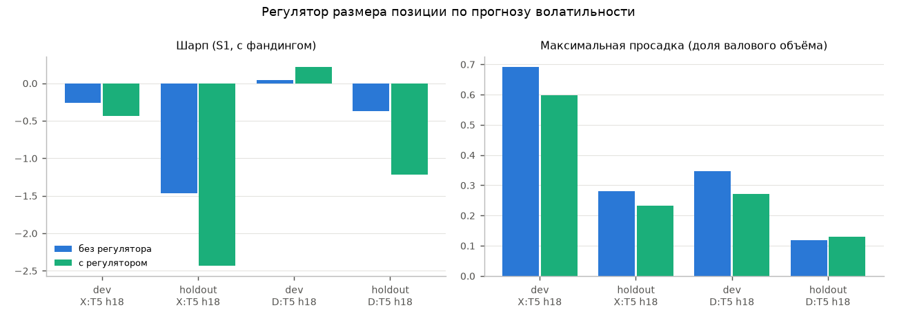

# Волатильность (T7) как цель и как регулятор размера позиции

T7 = ln RV, RV — сумма квадратов часовых лог-доходностей на окне от открытия бара t+1 до открытия бара t+1+h.
Базовая модель HAR — линейная регрессия на логарифмы прошлой RV за 6, 42 и 180 баров (сутки, неделя, месяц).
Модель с признаками — Ridge на HAR + признаки, отобранные тем же BH-отбором (пул по парам, как ветка D).
R² внешней выборки = 1 − SSE / сумма квадратов отклонений от среднего внешней выборки.

| period | h | model | r2_oos | mae | n | mean_selected |
|---|---|---|---|---|---|---|
| dev | 1 | HAR | 0.375 | 0.88 | 361643 | nan |
| dev | 1 | HAR+признаки | 0.379 | 0.878 | 361643 | 20 |
| dev | 6 | HAR | 0.517 | 0.585 | 361650 | nan |
| dev | 6 | HAR+признаки | 0.522 | 0.582 | 361650 | 20 |
| dev | 18 | HAR | 0.539 | 0.501 | 361650 | nan |
| dev | 18 | HAR+признаки | 0.546 | 0.497 | 361650 | 20 |
| holdout | 1 | HAR | 0.453 | 0.966 | 83289 | nan |
| holdout | 1 | HAR+признаки | 0.457 | 0.961 | 83289 | 20 |
| holdout | 6 | HAR | 0.579 | 0.647 | 82890 | nan |
| holdout | 6 | HAR+признаки | 0.586 | 0.642 | 82890 | 20 |
| holdout | 18 | HAR | 0.633 | 0.536 | 81930 | nan |
| holdout | 18 | HAR+признаки | 0.641 | 0.532 | 81930 | 20 |

## Регулятор размера

Лучшая стратегия каждой ветки (по Шарпу на разработке, S1 с фандингом). Позиция актива умножается на
(медиана прогноза волатильности по активам на баре / прогноз волатильности актива), множитель ограничен [0,5; 2],
фиксируется на время удержания. `diff`, `lo`, `hi` — разность Шарпа «с регулятором − без» и её 90% интервал (парный блочный бутстреп).

| period | branch | target | h | sharpe_base | sharpe_reg | diff | lo | hi | mdd_base | mdd_reg | ret_base | ret_reg |
|---|---|---|---|---|---|---|---|---|---|---|---|---|
| dev | X | T5 | 18 | -0.261 | -0.436 | -0.175 | -0.674 | 0.303 | 0.69 | 0.598 | -0.057 | -0.079 |
| holdout | X | T5 | 18 | -1.466 | -2.437 | -0.971 | -1.802 | -0.053 | 0.279 | 0.232 | -0.302 | -0.365 |
| dev | D | T5 | 18 | 0.044 | 0.219 | 0.176 | -0.223 | 0.575 | 0.347 | 0.272 | 0.006 | 0.027 |
| holdout | D | T5 | 18 | -0.376 | -1.221 | -0.845 | -1.535 | -0.102 | 0.118 | 0.129 | -0.055 | -0.144 |

Правило «полезна как регулятор» (по разработке): нижняя граница интервала > 0, или просадка ниже на ≥ 20% при потере
чистой доходности ≤ 10%.

| branch | strategy | mdd_reduction | return_loss | useful |
|---|---|---|---|---|
| X | T5 h18 | 0.133 | nan | False |
| D | T5 h18 | 0.217 | -3.224 | True |

**Вердикт по волатильности: ПОЛЕЗНА КАК РЕГУЛЯТОР по правилу на разработке (D:T5 h18); на контроле разность Шарпа «с регулятором − без»: X -0.97 (90% ДИ -1.80 … -0.05), D -0.84 (90% ДИ -1.53 … -0.10).**

